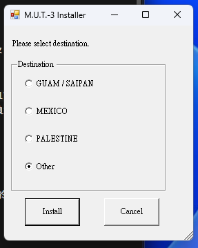
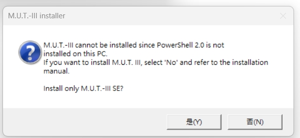
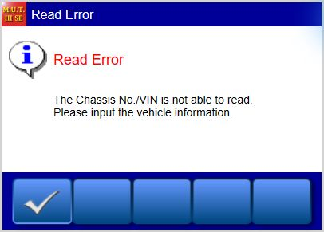
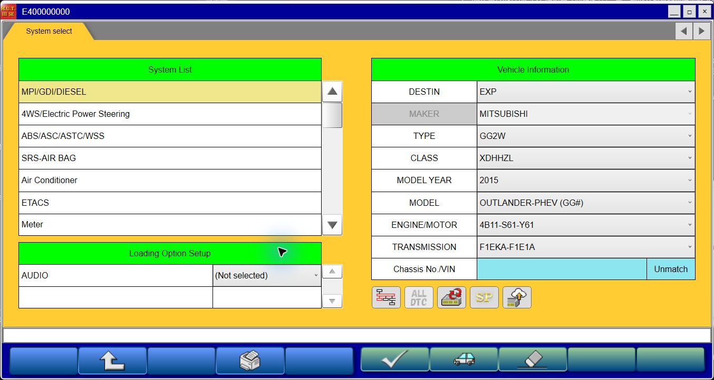
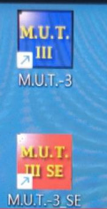

# SEW25091：Windows 11 一鍵引導安裝與圖文教學

本教學記錄 `SEW25091.zip` 在 Windows 11 原生安裝 **M.U.T.-3（傳統版）**與 **M.U.T.-3 SE** 的實測方法，包含 PowerShell 前置元件、SQL 安裝失敗重試，以及傳統版按啟動後沒有畫面的處理。

**本機驗收完成：安裝並重新開機後，傳統版顯示 `PRG23061-03`，SE 顯示 `SEW25091-00`，兩個 SQL 服務及資料庫狀態查詢通過。** 詳見第 7 節。這裡的可用範圍是程式啟動、介面及資料庫狀態；VCI、實車診斷、編程與寫入功能沒有測試。

本機成功處理的三個問題依序是：

1. SQL 安裝器要求已從新版 Windows 移除的 PowerShell 2.0 元件。
2. SQL Server 2014 SP1 的服務無法讀寫指定的 MDAC 通訊協定登錄鍵。
3. 傳統版由 launcher 開啟 `start.js` 時，需要先在 Windows 指定 **Microsoft Windows Based Script Host** 並選「一律／Always」。

本專案提供單一安裝入口、教學、截圖及本次使用與審查的輔助腳本。原廠 `SEW25091.zip` 需自行取得；根目錄另保留本次驗證過的 Microsoft 官方 [ps2DLC.zip](ps2DLC.zip) 原檔備份，隨專案一起下載，內容未修改。這是 Microsoft 第三方套件，本專案不將它宣稱為開源，也不替它新增授權。原因與修復結果見 [Windows 11 安裝問題報告](docs/windows11-installation-report.md)；先前每輪的失敗與重試細節保留於 [安裝調查紀錄](docs/installation-history.md)。

## 先看這裡：一鍵引導安裝

**一般使用者請從 [Install-MUT.cmd](Install-MUT.cmd) 開始。** 它會串接前置元件、原廠安裝、指定 SQL 修復與重啟後檢查。這是「單一入口引導」；Windows UAC、原廠選項、驅動精靈及程式首次啟動仍需要您按畫面確認。

**測試範圍：** 底層修復流程已在本機實際完成雙版本安裝。新整合入口另做隔離流程測試、目前成功主機的唯讀檢查及健康既有安裝的 `Auto` 驗收；**尚未重新執行新入口的全新安裝或失敗清理實機測試**，以免移除現有可用系統。下方的原廠成功截圖來自先前實際安裝，不代表已使用新入口重跑完整安裝。

**新入口檢查結果：2026-10-10 的 89／89 隔離測試通過。2026-10-11 00:11 檢查曾回傳待重啟 `3010`；00:24 完成重啟後，以原始 CMD 啟動的 `Auto` 於 00:28 通過系統與 SQL 檢查，00:35 完成兩版本主畫面的人工作答，最終退出碼 `0`、進度為 `Completed`。** 詳見下方 F 節。

### A. 放好檔案，再雙擊

**操作位置：** 檔案總管中已完整下載的本專案資料夾。保留 `scripts`，不要只下載單一 CMD。

若從 GitHub 的 **Code → Download ZIP** 下載專案，先將「專案 ZIP」完整解壓，再放入原廠 `SEW25091.zip`。兩者是不同檔案；不要在 ZIP 預覽視窗中執行入口。

| 要準備的內容 | 是否必要 | 放置方式 |
| --- | --- | --- |
| `Install-MUT.cmd` 與完整 `scripts/` | 必要 | 保持專案原本相對位置；`scripts` 內的 PS1、PSM1、CMD 與 `oneclick-helper-hashes.json` 都保留 |
| `SEW25091.zip` | 新安裝／清理重試必要 | 放在 `Install-MUT.cmd` 旁；使用第 1 節相同 SHA-256 的原廠安裝包 |
| `README.md` 與 `docs/` | 建議保留 | 提供離線教學、圖片與問題報告 |
| [ps2DLC.zip](ps2DLC.zip) | 專案已附原檔備份 | 保留在專案根目錄；`5,916,333` bytes（`5.642 MiB`），固定雜湊見第 3.2 節；缺少時腳本可從 Microsoft 官方下載 |

另外需要系統管理員權限與可用磁碟空間。已附 `ps2DLC.zip` 不代表可全程離線：NetFx3 仍可能需要 Windows Update；補充套件缺少且需從官方下載時也需要網路。不需另外準備 SQL 安裝包或 PowerShell 7。

```text
本專案資料夾\
├─ Install-MUT.cmd
├─ SEW25091.zip          ← 自行取得，檔名必須相同
├─ ps2DLC.zip            ← 專案已附，Microsoft 官方原檔備份
├─ README.md
├─ scripts\             ← 保留完整內容
└─ docs\
```

1. 儲存所有工作。若本機已有 M.U.T. 資料或 SQL 資料庫，先依原廠方式備份；日誌和登錄備份不等於資料庫備份。
2. 將 `SEW25091.zip` 放在 `Install-MUT.cmd` 旁。資料夾可含中文或空白；腳本會使用固定英文工作目錄 `C:\MUT-Install`。
3. 雙擊 **Install-MUT.cmd**；Windows UAC 出現時按「是」。入口會選擇 Windows 內建的 **64 位元 PowerShell 5.1**，不需安裝 PowerShell 7。
4. 保持主控與原廠視窗開啟。第一次核對約 1.86 GB 安裝包及完整解壓需要時間；依主控訊息等候，不要重複開啟。

**預期結果：** 先檢查目前系統，再決定進入驗收、安裝或停止檢查。健康的既有安裝不需 ZIP，也不會重新安裝。需要來源時，腳本只接受第 1 節列出的固定 SHA-256；既有解壓內容須核對相符，不覆蓋未知來源。

**若失敗：** 看彈出視窗中的原因、下一步與日誌位置。缺 ZIP 就放回同一資料夾；雜湊不符就重新核對來源。不要改檔名假裝符合版本或刪除檢查。

### B. 依畫面完成少數必要操作

| 出現畫面 | 您要做的操作 | 接下來的預期結果 |
| --- | --- | --- |
| Windows UAC | 按「是」允許管理員操作；拒絕會取消本輪 | 主控繼續檢查 |
| 符合條件的失敗安裝清理確認 | 核對列出的目標，確認已備份後才繼續 | 先執行原廠 `UNINST.BAT`，再依限定條件處理殘留 SQL |
| M.U.T.-III Version Checker | 按「是／Yes」 | 顯示地區選擇 |
| 地區選擇 | 選 **Other** → **Install** | 使用本次驗證的 `EXP` 安裝流程 |
| 驅動程式精靈 | 依序按 **Next／下一步**、**Finish／完成** | 原廠繼續安裝；驅動安裝完成不代表 VCI 已驗證 |
| 重新啟動提示 | 儲存工作，從 Windows 選 **重新啟動** | 重開後再次雙擊同一個 `Install-MUT.cmd` 接續 |
| `.js` 的開啟程式選擇 | 選 **Microsoft Windows Based Script Host** → **一律／Always** | 從桌面再次開啟傳統版；詳見第 7.2 節 |
| 雙版本主畫面確認 | 實際開啟兩程式，核對下面的版本後再確認 | 另外記錄使用者的主畫面驗收 |



在安裝分支中，主控依序尋找 `ps2DLC.zip`：先使用 `C:\MUT-Install\ps2DLC.zip` 快取；沒有快取才讀取本專案根目錄的 [原檔備份](ps2DLC.zip)；兩處都沒有才從 [Microsoft 官方下載位置](https://download.microsoft.com/download/2b37839b-e146-465a-a78c-c9066609c553/ps2DLC.zip) 取得。每個來源都必須通過第 3.2 節的固定 SHA-256 核對，才會解壓與執行；已有檔案但雜湊不符時會停止，不會跳過檢查或自動換用另一份。套件用途見 [Microsoft 官方暫時方案](https://support.microsoft.com/en-us/servicing/os/windows/docs/2025/08/powershell-2-0-removal-from-windows)。NetFx3 仍可能需要 Windows Update，因此附帶 ZIP 不代表整個流程可離線執行。

### C. 重啟接續與失敗重裝

**只需在重開後再次雙擊同一入口。** 主控保存進度並核對真正的 Windows 開機時間；不會代您重新開機，也不會新增開機自動執行項目。請使用「重新啟動」，不要把登出或關閉主控視窗當成重啟。

| 系統目前狀態 | 一鍵入口的行為 |
| --- | --- |
| 已是本次版本，服務、資料庫與安裝檢查健康 | 只進入驗收，不安裝或清理 |
| 未安裝、沒有未知殘留 | 驗證來源、準備前置元件，再啟動原廠安裝 |
| 符合本次失敗條件的指定 SQL 實例 | 顯示清理目標；明確確認備份後才走原廠解除安裝及限定清理 |
| 未知版本、有效資料庫或無法辨識的殘留 | 停止並提供檢查資訊，不自動移除 |
| 原廠安裝仍在進行且可確認屬於本輪 | 接回監控，不開第二份安裝器 |
| 待重啟、進度檔損毀或現況與記錄矛盾 | 顯示所需操作；不直接重播清理步驟 |

如果原廠或 SQL 視窗仍在執行，先保留現場。主控逾時只停止自己的監控，不強制結束安裝器。SQL 監控上限為 45 分鐘，原廠整體監控上限為 90 分鐘。SQL 先回報成功時，仍需等其他元件完成。

引導式清理僅接受本次核對的 SQL 2014 SP1 x86／MDAC `0x5／0x90` 失敗。清理前另核對現有引擎版本、目前 ERRORLOG 與資料檔；出現成功服務、使用者資料庫、其他版本、無服務但有 SQL 登錄殘留，或舊版 `Program Files\MUT3` 目錄時，會停止並要求人工檢查。只有「安裝失敗」四個字不足以允許自動清理。

若主控曾被關閉，接續時也會重新核對程序來源；來源不明或無法確認屬於本輪的安裝程序，不會被自動接管或終止。

### D. 成功要確認什麼

主控會分開記錄 **系統檢查通過** 與 **使用者確認主畫面**。安裝流程須有本輪新增的最後 `InstLog.txt` 檢查區塊以「問題なし」結束、相關安裝程序穩定結束至少 10 秒，以及安裝完成後的實際重啟，才進入最後驗收。

1. 系統檢查核對兩個 SQL 服務、必要資料庫與檔案；任何缺失都會列入報告。
2. 從桌面開啟 **M.U.T.-3**，確認主畫面底部 **`Ver.PRG23061-03`**。
3. 從桌面開啟 **M.U.T.-3_SE**，確認主畫面底部 **`Ver.SEW25091-00`**。
4. 只有實際看見兩個正確畫面才確認；沒有開啟或版本不符時，保留「待人工確認」，不要用兩個捷徑代替驗收。成功畫面見第 7.2、7.3 節。

### E. 錯誤提示、退出碼與唯讀檢查

錯誤視窗會列出 **失敗階段、中文摘要、原始錯誤碼、下一步與完整日誌路徑**。請一併保存發生時間與畫面；原始安裝／SQL 日誌保留供追查。

| 檔案位置 | 用途 |
| --- | --- |
| `C:\MUT-Install\oneclick-state.json` | 重啟接續用的檢查點，不要手動修改或刪除來跳過階段 |
| `C:\MUT-Install\oneclick-logs\<時間戳記-guid>\result.json` | 每次主控的結果、檢查發現及相關報告位置 |
| 同一目錄下的 `events.log` 及子程序輸出 | 流程時間、命令結果及錯誤追查 |
| `C:\MUT-Install\verification-logs\...\report.json` | SQL 唯讀驗收；當次主控結果會指向對應報告 |

| 退出碼 | 意義 | 如何處理 |
| --- | --- | --- |
| `0` | 目前模式檢查通過 | `Check` 只代表系統檢查通過；仍須實際核對兩程式 |
| `3010` | 等待重新啟動 | 儲存工作並重新啟動，再雙擊同一入口 |
| `1223` | 使用者取消 | UAC 或其他確認已取消，處理完成後可重新執行 |
| `2` | 需要人工確認／檢查 | 按視窗列出的原因處理，保留日誌，不強行略過 |
| `1` | 執行失敗 | 依原始錯誤與日誌排查，不會無限重試 |

若只想查目前狀態，在**本專案根目錄的 Windows PowerShell 5.1** 執行下列命令；未提升權限時仍會請求 UAC：

```powershell
& "$env:SystemRoot\System32\WindowsPowerShell\v1.0\powershell.exe" `
    -NoProfile -ExecutionPolicy Bypass -File '.\scripts\Install-Mut.ps1' -Mode Check
```

需要不彈視窗的檢查（例如收集報告）可在命令最後加上 `-NoUI`。`-NoUI` 僅適用於 `-Mode Check`；一般安裝使用預設的 `Auto` 模式。Check 只讀取系統並寫出本次報告，不下載、不安裝、不清理、不修改系統設定。命令的 `-ExecutionPolicy Bypass` 僅用於此次 PowerShell 行程，不永久設定執行原則。

### F. 新入口的測試結果

| 驗證方式 | 實測結果 | 限制 |
| --- | --- | --- |
| Windows PowerShell 5.1 隔離測試 | 2026-10-10 **89／89 通過**，退出碼 `0` | 使用暫存檔及模擬系統操作；沒有執行原廠安裝、清理或重啟 |
| 新入口 `-Mode Check -NoUI` | **2026-10-10 23:16:06 通過**，`ModeChecksPassed`、退出碼 `0`、Findings 為空陣列 | 是既有成功電腦的唯讀驗收，不是重新安裝 |
| 重啟前追加唯讀驗收 | **2026-10-11 00:11:12**：SQL 與安裝檢查 `Passed=true`、`Findings=[]`；整體為 `AwaitingReboot`／`3010` | 偵測到 Windows 待重啟檔案操作；已於 00:24 實際重啟，後續見下一列 |
| 重啟後原始 CMD／Auto 入口 | **2026-10-11 00:35:07 完成**：系統檢查通過、`Classic=true`、`SE=true`、`ExitCode=0`、`Phase=Completed` | 驗證健康既有安裝只做驗收；沒有重新安裝或清理，不代表全新安裝分支已實測 |
| 此次 Check 檢查內容 | SQL 服務／版本／資料庫、必要啟動檔、SE `Version.xml`、傳統版最後紀錄及登錄版本、兩個捷徑的目標與參數均符合 | 沒有用 Check 取代使用者主畫面確認 |
| 前置元件唯讀核驗 | 32 個官方來源 DLL 對應 **17／17 GAC 身分**相符，兩個登錄檢視及四項執行原則恢復核對通過 | 沒有重新執行載入器 |
| 新入口的全新安裝、解除安裝與跨重啟整合流程 | **尚未重新實機測試**；已測模擬分支 | 原有逐步修復的實機證據保留於後文，兩種結果不可混用 |

追加驗收讀到的 `PendingFileRenameOperations` 全部指向 Windows 的 `spool\V4Dirs` 列印元件目錄；當時 CBS 與 Windows Update 的重啟標記均未出現。這些項目不是 MUT／SQL 安裝目錄，也沒有證據可判定由哪個程序新增。助手保留標記並提示儲存工作、重新啟動後再次檢查；本輪沒有重新安裝、清理或修改登錄。

2026-10-11 00:24:19.5 完成實際重啟。00:28 從原始 `Install-MUT.cmd` 進入 `Auto` 後，先前待重啟狀態已解除，兩 SQL 服務、52 個可見資料庫、必要檔案及版本均通過。SE 由原桌面捷徑啟動後再次顯示 `SEW25091-00`；使用者在本輪助手重新確認傳統版 `PRG23061-03` 與 SE `SEW25091-00` 主畫面。00:35:03 保存 `Classic=true`、`SE=true`，進度為 `Completed`；00:35:07 主控結束，`Mode=Auto`、`Status=ModeChecksPassed`、`ExitCode=0`、`Findings=[]`、`Error=null`。這次沒有重新安裝或清理，只保存驗收報告及完成進度；VCI／實車仍未測試。


隔離案例涵蓋來源／雜湊錯誤、中文路徑、ZIP 路徑穿越、未知檔案保留、狀態損毀、UAC 取消、重複執行、拒絕清理、真正重啟判斷、舊成功紀錄、SQL 先完成、逾時、下載失敗及既有資料保護。

維護者可在專案根目錄重跑 [隔離測試](tests/Test-OneClick.ps1)，不需管理員權限：

```powershell
& "$env:SystemRoot\System32\WindowsPowerShell\v1.0\powershell.exe" `
    -NoProfile -ExecutionPolicy Bypass -File '.\tests\Test-OneClick.ps1'
```

測試摘要保存於 `.local-evidence/oneclick-tests.json`，原始本機驗收結果位於前述 `oneclick-logs`。這些原始資料排除於 GitHub；教學保留整理後的結果及既有實測圖片，沒有製作假的成功畫面。

## 進階手動流程與實測證據

以下第 1–11 節保留逐階段操作、既有輔助腳本及實測截圖，供排查與審查使用。採用上方一鍵入口時，不需另外執行下方每支 CMD；避免同時開啟兩套安裝流程。

## 1. 適用環境與驗證範圍

| 項目 | 本次實測 |
| --- | --- |
| 日期 | 2026-10-10，台灣時間 |
| 系統 | Windows 11 Pro，x64 |
| OS build／DisplayVersion | `26300.9457`／`26H2`，以本機讀值為準 |
| 安裝包 | `SEW25091.zip`，`1,865,952,877` bytes |
| 解壓目錄 | `C:\MUT-Install\SEW25091` |
| 地區 | `Other`，對應 `EXP` |
| 內附 SQL | SQL Server 2014 Express SP1，x86，`12.0.4100.1` |
| 安裝完成後重啟 | 2026-10-10 22:06:01.5 |
| 尚未驗證 | 其他 Windows build、其他地區、VCI／車輛連線及資料庫完整性 |

安裝包 SHA-256：

```text
1B1740A1834B0AF447A17BFFB2A220671728FBC9C8CB851C5F01859912427D03
```

本次 ZIP 的所有項目 CRC 檢查通過。雜湊用於辨識與本次相同的檔案，不能代替原廠簽章或安全性認證。

**本機實測與官方支援分開看。** Microsoft 的相容性表將 SQL Server 2014 搭配 Windows 11 列為不支援，本教學不改變該支援狀態，也不能保證其他電腦相同結果。[Microsoft SQL／Windows 相容性表](https://learn.microsoft.com/en-us/troubleshoot/sql/database-engine/install/windows/use-sql-server-in-windows)

## 2. 安裝前準備

**操作位置：** 現有電腦、Windows 檔案總管與 Windows PowerShell。

1. 儲存工作；前置元件、清理及完整安裝都可能各自要求重新開機。
2. 若已有 M.U.T. 診斷資料、有效 SQL 資料庫或其他軟體共用 SQL，先依原廠方式備份。下面的清理會移除指定失敗執行個體，不適合當作無損更新。
3. 保留安裝前的系統備份。輔助腳本的登錄匯出、ACL 備份及元件清單，**不是資料庫備份，也不是整台 Windows 的還原映像**。
4. 執行 `winver`，記下 OS 組建。在 Windows PowerShell 保存 `Get-ExecutionPolicy -List` 的輸出。
5. 確認先前安裝／解除安裝程序已結束。依畫面完成要求的重啟後，再開始下一輪。

**預期結果：** 已掌握既有資料、系統版本與執行原則，並有可用的備份。**若不符：** 先處理既有資料與安裝狀態，不要直接執行清理腳本。

### 核對 ZIP 並完整解壓

在檔案總管進入 ZIP 所在資料夾，於該處開啟 PowerShell：

```powershell
Get-Item -LiteralPath '.\SEW25091.zip' | Select-Object Name, Length
Get-FileHash -LiteralPath '.\SEW25091.zip' -Algorithm SHA256
New-Item -ItemType Directory -Path 'C:\MUT-Install' -Force | Out-Null
Expand-Archive -LiteralPath '.\SEW25091.zip' -DestinationPath 'C:\MUT-Install'
Test-Path -LiteralPath 'C:\MUT-Install\SEW25091\MUT3_Install.bat'
```

ZIP 本身含有一層 `SEW25091`，目的地不需再加一層同名目錄。解壓應使用沒有舊來源檔案的新目錄，最後一行預期為 `True`。若雜湊不同，先確認來源或版本；若解壓失敗，檢查完整性與磁碟空間。不要從 ZIP 預覽中直接執行，也不要只解壓單一 EXE。

### 複製本專案腳本

在**本 GitHub 專案根目錄**開啟 PowerShell，執行：

```powershell
Copy-Item -Path '.\scripts\*' -Destination 'C:\MUT-Install'
```

預期 `C:\MUT-Install` 中至少有下表列出的 9 個既有輔助檔案，`SEW25091` 子目錄中有原廠入口及 `INSTALL`。本節的 CMD 使用固定路徑，因此請從複製後的位置操作；一鍵入口則直接從專案根目錄執行。

| 入口／腳本 | 用途 |
| --- | --- |
| [Run-MutRepair.cmd](scripts/Run-MutRepair.cmd)／[Repair-MutPrerequisites.ps1](scripts/Repair-MutPrerequisites.ps1) | 啟用 NetFx3、執行官方 PowerShell 暫時方案並恢復相關執行原則 |
| [Run-MutInstallWithSqlAcl.cmd](scripts/Run-MutInstallWithSqlAcl.cmd)／[Start-MutInstallWithSqlAcl.ps1](scripts/Start-MutInstallWithSqlAcl.ps1) | 啟動原廠完整安裝，監看本輪 SQL 並處理已確認的特定權限錯誤 |
| [Repair-MutSqlLegacyAcl.ps1](scripts/Repair-MutSqlLegacyAcl.ps1) | 由監看程序呼叫，備份並限定調整指定實例的三個登錄鍵權限 |
| [Run-MutCleanRetry.cmd](scripts/Run-MutCleanRetry.cmd)／[Remove-FailedMutSqlInstances.ps1](scripts/Remove-FailedMutSqlInstances.ps1) | 清理符合本次失敗特徵的兩個 SQL 引擎，再進入安裝 |
| [Run-MutVerification.cmd](scripts/Run-MutVerification.cmd)／[Verify-MutSqlInstallation.ps1](scripts/Verify-MutSqlInstallation.ps1) | 重啟後唯讀查詢 SQL、必要檔案與安裝紀錄 |

腳本需要系統管理員權限及 **64 位元 Windows PowerShell 5.1**；CMD 會指定系統內建主程式。不要改用 PowerShell 7 代替依賴。重要檔案有 SHA-256 檢查；`.gitattributes` 保留腳本原始位元組，避免 Git 自動換行影響雜湊。若檢查失敗，核對檔案與版本，不要移除檢查強行執行。

## 3. 處理 PowerShell 2.0 前置條件

以下是**使用者最初提供的參考圖**，不是本機最終安裝畫面：



此畫面的「是／Yes」代表只安裝 SE；本教學需要雙版本，應選「否／No」並先處理依賴。本機實際重現的是 SQL 階段的 Windows 相容性警告，隨後資料庫設定失敗，見第 8 節。

Microsoft 自 2025 年 8 月的 Windows 11 24H2 更新開始移除 PowerShell 2.0。新版系統可能已沒有可勾選的 Windows 功能；請依 OS 版本判斷。[官方移除說明與暫時方案](https://support.microsoft.com/en-us/servicing/os/windows/docs/2025/08/powershell-2-0-removal-from-windows)

### 3.1 判斷可選功能

**操作位置：** 以系統管理員身分開啟 Windows PowerShell。

```powershell
Get-WindowsOptionalFeature -Online |
    Where-Object { $_.FeatureName -like '*PowerShellV2*' } |
    Select-Object FeatureName, State
```

有列出功能時，依該 Windows 版本及原廠手冊處理，再完成要求的重啟；沒有輸出時，不能解讀為已啟用。本次使用下方 Microsoft 官方暫時方案。若查詢遭拒絕存取，先確認是否使用管理員視窗。

### 3.2 準備官方補充元件

本專案附帶的 [ps2DLC.zip](ps2DLC.zip) 為本次使用的 Microsoft 官方原檔備份，大小 `5,916,333` bytes（`5.642 MiB`），沒有重新壓縮或修改內容。原始來源為 [Microsoft 官方下載](https://download.microsoft.com/download/2b37839b-e146-465a-a78c-c9066609c553/ps2DLC.zip)，用途與操作說明見 [官方文章的 Temporary mitigation](https://support.microsoft.com/en-us/servicing/os/windows/docs/2025/08/powershell-2-0-removal-from-windows)。它是 Microsoft 第三方套件；本專案不宣稱它是開源，也不替它新增授權。

一鍵入口會自動處理來源與解壓；只有採用進階手動流程時，才執行以下步驟：

1. 將專案根目錄的 `ps2DLC.zip` 複製到 `C:\MUT-Install\ps2DLC.zip`；也可從上方 Microsoft 官方下載位置取得。若目的地已有檔案，先核對雜湊，不直接覆蓋未知內容。
2. 計算 `Get-FileHash -LiteralPath 'C:\MUT-Install\ps2DLC.zip' -Algorithm SHA256`，本次審查版本應為下列值。
3. 完整解壓至 `C:\MUT-Install\ps2DLC`，保留 DLL、資源及登錄檔。ZIP 另含一層目錄，預期可找到 `C:\MUT-Install\ps2DLC\ps2DLC\loadGAC.ps1`。

```text
D9812E7BE1F72FF49D73F3179E207AA0000852D9D0EFD92455AD376FAD5D9B7C
```

若雜湊不同或 `loadGAC.ps1` 不存在，先確認下載版本與解壓層級，不要修改官方腳本或偽造登錄值。

### 3.3 執行修復並檢查結果

**操作位置：** 檔案總管中的 `C:\MUT-Install`。

1. 對 `Run-MutRepair.cmd` 按右鍵 →「顯示其他選項」→「以系統管理員身分執行」，允許 Windows UAC。
2. 保持視窗開啟。腳本備份相關設定，啟用 `.NET Framework 3.5`，再分別由 64／32 位元 Windows PowerShell 執行未修改的官方 `loadGAC.ps1`。NetFx3 可能需要 Windows Update 下載內容。
3. 結束時腳本會恢復官方載入器涉及的四項 `ExecutionPolicy` 原始存在狀態、型別和值。再比對安裝前的 `Get-ExecutionPolicy -List`。

| 結果 | 下一步 |
| --- | --- |
| 退出碼 `3010` | 儲存工作、重新開機，再執行同一個入口 |
| 退出碼 `0` | 閱讀 `C:\MUT-Install\repair-status.json` 及其日誌，確認載入與政策恢復結果 |
| 其他退出碼／`policy-restore-failed` | 先依記錄排除錯誤及恢復原政策，不繼續安裝 |

本機兩架構官方載入器均退出 `0`，NetFx3 啟用，17／17 GAC 組件核對相符，四項執行原則恢復。**這不等於真正啟動 PowerShell 2.0 引擎。** 在 64 位元 Windows PowerShell 中分別查詢：

```powershell
& "$env:SystemRoot\System32\WindowsPowerShell\v1.0\powershell.exe" `
    -Version 2 -NoProfile -NonInteractive -Command '$PSVersionTable.PSVersion.ToString()'
& "$env:SystemRoot\SysWOW64\WindowsPowerShell\v1.0\powershell.exe" `
    -Version 2 -NoProfile -NonInteractive -Command '$PSVersionTable.PSVersion.ToString()'
```

`-Version 2` 放在主程式之後的第一個參數。本次兩者都仍輸出 `5.1.26100.9444` 並提示回退；已通過的是後續 SQL 安裝器的前置檢查，不能只憑退出碼 `0` 記為 2.0 引擎可用。

## 4. 依目前狀態選擇安裝入口

| 目前狀態 | 使用的路徑 |
| --- | --- |
| 沒有 M.U.T. 既有資料、兩個目標 SQL 服務或 APP00 設定，也沒有待重啟／安裝程序 | 直接進入第 5 節，用 `Run-MutInstallWithSqlAcl.cmd` |
| 曾安裝失敗，與本次相同的 SQL MDAC `0x5／0x90` 錯誤，且 Setup 要求移除失敗功能 | 先完成本節的原廠解除安裝與指定 SQL 清理 |
| 已有可用資料庫，或安裝來源、SQL 帳號、版本、失敗原因不同 | 先備份並分析差異；這組清理腳本不適用 |

### 失敗後重裝：先 UNINST，再檢查殘留 SQL

**操作位置：** 檔案總管。先儲存資料並結束受影響的安裝流程，再以系統管理員執行：

```text
C:\MUT-Install\SEW25091\UNINSTALLER\UNINST.BAT
```

依原廠解除安裝手冊及畫面完成確認，出現重啟要求時重新開機。本機確實需要此步驟才能走乾淨安裝；但第二次執行後仍殘留停止狀態的 `MUT3` 與 `CAESARCOMPDB` SQL 引擎，不能假定 UNINST 已移除全部相依元件。

完成原廠解除安裝及重啟後，以系統管理員執行 `C:\MUT-Install\Run-MutCleanRetry.cmd`。它會檢查失敗日誌、實例名稱、帳號、版本及路徑，再由同一安裝包的 SQL Setup 逐一移除指定失敗 `SQLENGINE`；不手動刪除其他 SQL 服務或待重啟標記。

**預期結果：** 清理驗證通過才接續原廠安裝；若實例已確認不存在，會直接進入安裝前檢查。**若退出 `3010`：** 本次不開始重裝，儲存工作並重啟，再執行同一個 `Run-MutCleanRetry.cmd`。本機 SQL 清理確實產生 Windows Installer 待刪檔案，完成這次重啟後才能繼續。

**其他錯誤：** 查看 `C:\MUT-Install\sql-instance-removal-status.json`。腳本拒絕代表目前條件與已審查範圍不同；不要刪除殘留登錄鍵或以全域終止程序方式強行通過。

## 5. 完成原廠安裝

**操作位置：** `C:\MUT-Install`。乾淨安裝時，對 `Run-MutInstallWithSqlAcl.cmd` 按右鍵，以系統管理員身分執行。若第 4 節已由 `Run-MutCleanRetry.cmd` 接續啟動，沿用現有安裝畫面，不再開第二份。

1. 輔助程式檢查來源及狀態後，執行原廠 `MUT3_Install.bat`。
2. 在 `M.U.T.-III Version Checker` 選「是／Yes」。
3. 地區選 **Other**，按 **Install**；本次對應 `EXP`。
4. 保持原廠視窗及監看視窗開啟，依序等待基本系統、SMV、診斷軟體、SQL、資料庫與 SE 等階段。
5. 驅動精靈若出現，依畫面按「下一步／Next」與「完成／Finish」。本次驅動套件曾預載入，但沒有 VCI 實機測試。


**SQL 階段的預期行為：** 監看程序只讀取本輪新產生且設定符合的 SQL 日誌。辨識到本次特定 MDAC 權限錯誤後，先備份，再加入該實例服務 SID 對三個既有登錄鍵的 `ReadKey／WriteKey` 繼承權限，每個實例最多一次，等待原廠 SQL Setup 自行重試。

限定範圍位於 **Registry64** 的以下位置，實例僅限 `MUT3` 與 `CAESARCOMPDB`：

```text
HKLM\SOFTWARE\Microsoft\Microsoft SQL Server\<instance>\MSSQLServer\SuperSocketNetLib
HKLM\SOFTWARE\Microsoft\Microsoft SQL Server\<instance>\MSSQLServer\SuperSocketNetLib\Tcp
HKLM\SOFTWARE\Microsoft\Microsoft SQL Server\<instance>\MSSQLServer\SuperSocketNetLib\Np
```

腳本會先核對對應 32 位元參考權限；不替換 SQL 版本、改服務帳號或擴大到整個登錄樹。本次兩個 SQL 安裝在此修正後均 `Passed`。這是本機特定錯誤的修復，不是通用 SQL 權限調整指令。

監看最多 45 分鐘。**退出 `0`／`sql-engines-completed` 只代表兩個 SQL 曾安裝通過及啟動；原廠可能仍在安裝其他元件。** 非零、逾時或再次出錯時，保留 `C:\MUT-Install\sql-acl-coordinator-status.json` 與日誌；監看停止不等於原廠程序已停止，先檢查目前畫面，不要另開安裝器。

## 6. 完成畫面與重新開機

**預期畫面：** 原廠 Package 3/3 顯示更新／安裝完成，並要求重新啟動。下圖為**本次第三輪實測截圖**：


1. 查看 `C:\MUTSW\InstLog.txt`，本次最後為 **「問題なし」**，表示原廠這項安裝檢查未發現問題。
2. 儲存工作並重新啟動 Windows；不能用登出或先前清理階段的重啟代替。
3. 重啟後再做第 7 節的 SQL 與雙程式驗收。

若仍列出資料庫缺失或錯誤，保留原文與對應 SQL 日誌。只有完成訊息或桌面捷徑，不足以宣告成功。

## 7. 重啟後驗收，以及傳統版啟動修復

### 7.1 先檢查 SQL 與資料庫

**操作位置：** 檔案總管，對 `C:\MUT-Install\Run-MutVerification.cmd` 按右鍵，以系統管理員執行。

**預期結果：** 退出碼 `0`；最新 `C:\MUT-Install\verification-logs\<時間戳記>\report.json` 的 `Status` 為 `ReadOnlyChecksPassed`，`Findings` 為空。另確認報告的開機時間晚於完整安裝完成時間；`AfterReboot` 標籤本身不能證明已重啟。

| 2026-10-10 22:12 本機查詢 | 結果 |
| --- | --- |
| `MSSQL$MUT3`、`MSSQL$CAESARCOMPDB` | 均為 `Running／Auto` |
| SQL 引擎 | 均為 `12.0.4100.1` |
| MUT3 實例 | 46／46 可見資料庫 `ONLINE` 且查詢帳號可存取 |
| CAESARCOMPDB 實例 | 6／6 可見資料庫 `ONLINE` 且查詢帳號可存取 |
| 必要資料庫 | `MUTMCB`、`CAESARCOMPDB2`、`CFFDB` 均 `ONLINE／MULTI_USER` |
| 必要資料檔 | 六個 MDF／LDF 均存在且大小非零 |

查詢使用本機 shared memory 及管理員 Windows 整合驗證，不變更 SQL 資料或啟停服務。數量包含系統資料庫；結果不能代替資料庫完整性檢查或應用程式每一項功能測試。

**若失敗：** 依報告指出的實例、資料庫或檔案回查 SQL Summary／ERRORLOG，不要因 SE 畫面可開就略過傳統版依賴的 SQL。

### 7.2 傳統版：指定 `.js` 的開啟程式

**操作位置：** Windows 桌面，開啟 **M.U.T.-3**。首次顯示使用條款時，閱讀並依畫面確認，再按啟動。

本機曾發生「條款已確認，launcher 關閉，主畫面沒有出現」。傳統版入口會交由 Windows 開啟 `C:\MUTSW\MUT3\MENU\SCRIPT\start.js`。即使查到 `JSFile` 登錄關聯，也不能代替完成 Windows 的實際選擇畫面。

1. Windows 詢問使用哪個應用程式開啟 `.js` 時，選 **Microsoft Windows Based Script Host**。
2. 按 **一律／Always**，讓後續傳統版啟動沿用這個選擇。
3. 若選單沒有該項目，可用「在電腦上選擇應用程式」指定 `C:\Windows\System32\wscript.exe`，不要選文字編輯器或瀏覽器；此手動選檔分支未於本次重做。原廠手冊第 7 頁所示的實測成功操作是選 Script Host，再按 Always。
4. 回到桌面重新開啟 **M.U.T.-3**，確認進入主畫面。

**本次結果：** 使用者完成 Script Host＋Always 後，回覆傳統版與 SE 都可以開啟；`UserChoice` 的 `ProgId` 為 `JSFile`。這一步會影響此帳號對 `.js` 檔案的預設開啟方式。

**主畫面已確認：** 22:06 安裝後重啟以後，本次於 22:34 再次由原桌面捷徑啟動，出現 `MCP - WINDEX - Internet Explorer`。使用者提供的實測截圖顯示傳統版主畫面、`SMV／STV` 按鈕及 **`Ver.PRG23061-03`**。


這張是本次安裝完成後的實際畫面，不是最初的桌面圖示參考圖。本次傳統版驗收範圍為啟動與版本，未另外完成傳統版 STV 功能、VCI 或車輛測試。

本次最終處理沒有採用 Edge／IE 相容模式變更，也沒有保留啟動原始碼修改。若指定 Script Host 後仍失敗，先記錄時間、提示與安裝結果，確認是否與本次相同；不要重裝已驗收通過的 SQL，或把更換瀏覽器當作本項修復。

### 7.3 SE：確認主畫面與離線選單

**操作位置：** Windows 桌面的 **M.U.T.-3_SE**。依首次條款畫面完成確認。

**預期畫面：** `MUT3-SE` 主畫面有 `SMV`、`STV`、`Configuration`，底部為 **`Ver.SEW25091-00`**。下圖是本次重啟後的實測畫面：


本次未連接 VCI／車輛，按 `STV` 時顯示無法讀取 Chassis No./VIN。確認提示後可進入離線 `System select`。





畫面上的 `GG2W／2015／OUTLANDER-PHEV` 是當時的選擇值，VIN 空白，並非讀取到的實車資訊。若主畫面未出現、版本不符或出現資料庫／檔案錯誤，保存訊息並回查安裝，不要把全部錯誤都歸因於未連接 VCI。

### 7.4 驗收清單

- [x] 原廠完整安裝結束，`InstLog.txt` 結尾「問題なし」。
- [x] 安裝完成後重新啟動 Windows。
- [x] 兩個 SQL 服務及 52 個可見資料庫狀態查詢通過。
- [x] SE 主畫面與 `SEW25091-00` 已截圖，離線選單可載入。
- [x] 使用者確認 Script Host＋Always 後兩版本可開啟。
- [x] 原桌面捷徑再次啟動傳統版，主畫面與 `PRG23061-03` 已核對並保存實測圖。
- [x] 前置元件載入涉及的四項 PowerShell 執行原則恢復原值。
- [ ] VCI／車輛連線、診斷、編程及寫入：本次範圍外，未測試。

## 8. 常見錯誤與處理位置

| 現象 | 處理方式 |
| --- | --- |
| 缺少 PowerShell 2.0，詢問是否只裝 SE | 第 3 節；需要雙版本時不以 SE 單裝為完整成功 |
| Windows 功能沒有 PowerShell 2.0 | 查 OS build 與官方移除說明，再判斷官方暫時方案 |
| `-Version 2` 正常結束但顯示 `5.1...` | 是回退引擎，以實際版本記錄，不能宣稱恢復 2.0 |
| `Failed to setup databases.` | 查前面的 SQL 失敗原因；按「確定」不會修復資料庫 |
| `Instance does not exist.` | 本次為 SQL 引擎安裝失敗的連帶結果，先處理 SQL |
| `0x851A0019`／Database Engine startup handle | 只是啟動失敗摘要，需閱讀 ERRORLOG |
| `17182`、`0x5／0x90`、MDAC protocol list access denied | 本次第 4、5 節限定清理與權限流程已解決；其他原因不套用 |
| 輔助腳本返回 `3010` | 儲存工作並重啟，再執行同一入口，不刪除待重啟標記 |
| Hash／來源／帳號／路徑檢查拒絕 | 比對本機與本次條件，不移除檢查或擴大權限 |
| 安裝清單先寫 `Installation 1/3 was completed` | 可能是預列的進度項目，必須看最終結果及日誌 |
| 兩個桌面圖示都有，但傳統版不開 | 先看第 7.2 節的 Script Host 開啟方式，再做實際啟動驗收 |
| SE 無法讀取 VIN | 未連車時本次有出現；能開離線選單仍不代表 VCI 連線通過 |

以下是**使用者在本次第一輪安裝時提供的錯誤截圖**：


日誌主要位置：`C:\MUTSW\InstLog.txt`、`C:\Program Files (x86)\Microsoft SQL Server\120\Setup Bootstrap\Log`，以及 `C:\MUT-Install` 內各輔助程序的 `*-status.json` 與日誌目錄。保存錯誤時需同時記錄發生時間與安裝階段，避免混淆不同輪的 Summary。

## 9. 復原方式與限制

| 項目 | 已驗證範圍與處理 |
| --- | --- |
| 原廠 M.U.T. 解除安裝 | 已執行 `UNINSTALLER\UNINST.BAT`，完成要求的重啟；以隨附解除安裝手冊為準 |
| 本次失敗 SQL 引擎 | 同一媒體的 SQL Setup 移除兩個指定 SQLENGINE 已成功；共用服務由 SQL Setup 管理，不手動全刪 |
| 執行原則 | 四項原始存在狀態、型別和值已由輔助程序恢復並核對 |
| SQL ACL | 每實例三鍵的原始 DACL、owner 與值有備份；`-Restore` 路徑尚未實測，不能列為已驗證復原 |
| 官方 GAC 元件 | 官方暫時方案沒有附本次驗證過的完整卸載程序；刪除 ZIP／資料夾或跑 UNINST 不會完整還原它們 |
| `.js` 開啟關聯 | 透過 Windows「預設應用程式／選擇開啟方式」調整；本次選 Script Host＋Always，未測恢復前值 |
| 整體系統復原 | 需要安裝前備份；本專案日誌、REG 匯出及 ACL JSON 無法代替 |

ACL 還原功能會先要求同一電腦、實例、owner 與目前 DACL 符合當初備份；若後來已有其他變更會拒絕。沒有驗證過的復原程序不應直接在可用系統試跑。完整各輪清理證據見 [歷史紀錄](docs/installation-history.md)。

## 10. 圖片、檔案與 GitHub

- `Install-MUT.cmd`／`scripts/Install-Mut.ps1`：新的單一入口與主控，提供引導安裝及唯讀檢查。
- `README.md`：一鍵入口使用方式、進階手動操作與實測證據。
- `docs/windows11-installation-report.md`：Windows 11 原始失敗原因、修復方式及驗證限制。
- `docs/installation-history.md`：修復過程與前次狀態快照，歷史待辦不代表最終結果。
- `docs/images/`：原始 PNG／JPEG。`reference-` 是使用者最初提供的參考圖；`02` 至 `10` 是使用者於第一輪提供的實測過程；`24` 為使用者提供的本次傳統版成功畫面；其餘數字圖片由本次操作擷取，圖說標示所屬階段。
- `scripts/`：新的主控及本次使用與審查的既有輔助檔案；原始位元組由 `.gitattributes` 保留。
- [ps2DLC.zip](ps2DLC.zip)：未修改的 Microsoft 官方第三方套件備份，大小與 SHA-256 見第 3.2 節；不屬於本專案自製程式碼。
- `.gitignore`：排除原廠 `SEW25091.zip`、其他安裝封存檔、原廠 EXE／DLL、解壓內容、原始日誌、登錄匯出及 `.local-evidence`；僅根目錄的 `ps2DLC.zip` 列為 ZIP 例外。

使用者最初提供的兩個圖示只用於辨識，不能取代本次程式畫面：



公開內容包含教學、輔助腳本、測試、圖片及上述 `ps2DLC.zip` 原檔備份。每次提交前仍應檢查檔案清單，不上傳原廠 `SEW25091.zip` 或含機器名稱、使用者資料、車輛資訊及憑證的原始紀錄。

## 11. 參考資料

- [Microsoft：PowerShell 2.0 移除與官方暫時方案](https://support.microsoft.com/en-us/servicing/os/windows/docs/2025/08/powershell-2-0-removal-from-windows)
- [Microsoft：SQL Server 與 Windows 相容性](https://learn.microsoft.com/en-us/troubleshoot/sql/database-engine/install/windows/use-sql-server-in-windows)
- [Microsoft：SQL Server 服務帳號及存取權限](https://learn.microsoft.com/en-us/sql/database-engine/configure-windows/configure-windows-service-accounts-and-permissions#service-configuration-and-access-control)
- [Microsoft：SQL Setup 指定功能移除參數](https://learn.microsoft.com/en-us/sql/database-engine/install-windows/install-sql-server-from-the-command-prompt#uninstall-parameters)
- 原廠安裝手冊：`C:\MUT-Install\SEW25091\M.U.T.-3_Update_Installation_Manual(SEW25091).pdf`，第 7 頁含首次 Script Host 開啟方式。
- 原廠解除安裝手冊：`C:\MUT-Install\SEW25091\M.U.T.-3_Uninstallation_Manual(SEW25091).pdf`。
