> **歷史調查快照：2026-10-10，傳統版 `.js` 開啟關聯問題排除之前。**
>
> 本頁保留各輪失敗、重試、解除安裝與 SQL 修復的原始調查紀錄。下文的「目前狀態」、「尚未通過」及待辦是當時的判斷，不能當作最終結果。請先閱讀 [最新安裝教學與驗收結果](../README.md)；不要依本頁時間順序重做每一輪失敗實驗。
>
> 後續使用者在 Windows「選擇開啟方式」將 `.js` 指定給 **Microsoft Windows Based Script Host** 並選「一律／Always」，確認傳統版與 SE 都能開啟。最終畫面、版本及測試範圍統一列於主 README。

# SEW25091：Windows 11 安裝紀錄與圖文教學

本文件整理 `SEW25091.zip` 的 M.U.T.-III（桌面名稱 **M.U.T.-3**）及 **M.U.T.-3 SE** 安裝流程，重點是 Windows 11 出現「未安裝 PowerShell 2.0」時如何辨識原因，以及如何確認兩套程式真的可用。

**目前狀態：安裝完成並已重新開機，SQL 與 SE 啟動驗收通過；傳統版 M.U.T.-3 主畫面仍未通過驗收。** 第三輪套用各實例的限定登錄權限後，兩個 SQL 安裝均 `Passed`，21:59:22 的 `C:\MUTSW\InstLog.txt` 結尾為「問題なし」。Windows 已於 **22:06:01.5** 重啟；22:12 的本機查詢確認兩個 SQL 服務均為 `Running／Auto`，`MUT3` 的 46 個與 `CAESARCOMPDB` 的 6 個可見資料庫均 `ONLINE` 且查詢帳號可存取。重啟後由桌面捷徑啟動的 **M.U.T.-3 SE 已顯示主畫面與 `Ver.SEW25091-00`**，並可進入離線車型／系統選擇畫面。傳統版則在接受首次啟動條款後未出現主畫面，仍在調查；因此尚不能將本次記為雙版本完整成功。詳細圖片與驗收範圍見第 8 節。

兩種架構的 Windows PowerShell 執行 `-Version 2` 仍回退至 `5.1.26100.9444`，不能宣稱實際啟動了 2.0 引擎；已通過的是本次 SQL 安裝器的前置檢查。

第一輪的實際問題是：SQL 安裝階段出現 PowerShell 2.0 相容性警告，隨後顯示 `Failed to setup databases.`，CANBus 安裝再出現 `Instance does not exist.`。SQL 日誌確認安裝器啟用 `MicrosoftWindowsPowerShellV2` 失敗；不能只憑 Windows「程式相容性助理」警告推定所有 SQL 元件都未執行。以下依序保留各輪安裝、解除安裝及重試的證據。

本專案提供文件、圖片及前置元件輔助腳本，不重新散布原廠安裝包或 Microsoft 元件。請使用您已合法取得的原廠安裝檔，並從 Microsoft 官方網站取得補充元件。本次不包含 VCI、VCI-3 或車輛連線測試。

## 1. 先看懂錯誤訊息

以下是使用者提供的錯誤參考圖，**不是本次測試擷取的畫面**：


這個視窗表示傳統版 M.U.T.-III 的安裝條件未通過，接著詢問是否只安裝 M.U.T.-III SE：

| 按鈕 | 意義 | 本教學的處理方式 |
| --- | --- | --- |
| 是／Yes | 接受只安裝 SE 的路徑 | 本次目標包含傳統版，因此不以此作為完整成功 |
| 否／No | 不接受只安裝 SE，依手冊處理依賴 | 記錄訊息、結束此輪安裝，先排除缺少的依賴 |

以下是使用者提供的預期桌面圖示，**僅供辨識捷徑**：


**桌面出現兩個捷徑，不等於兩套程式都已安裝成功。** SE 的安裝流程也可能建立兩個圖示；最後必須分別啟動程式、確認主畫面與版本，重新開機後再測一次。

**本次實際卡關點與上方參考圖不同。** 使用者由原廠入口選擇 `Other → Install` 後，已進入系統檔案及診斷軟體的安裝；到 SQL Server 2014 Express 階段，Windows 程式相容性助理才要求 PowerShell 2.0，接著資料庫設定失敗。完整實測圖片與判讀見第 7.1 節。

## 2. 測試環境與支援限制

| 項目 | 本次紀錄 |
| --- | --- |
| 紀錄日期 | 2026-10-10（台灣時間） |
| 系統 | Windows 11，64 位元 |
| Windows build | `26300.9457` |
| 登錄檔 DisplayVersion | `26H2`（本機讀值，不代表其他版本的驗證結果） |
| 安裝包 | `SEW25091.zip` |
| 檔案大小 | `1,865,952,877` bytes |
| 安裝來源目錄 | `C:\MUT-Install\SEW25091` |
| 區域選擇 | `Other`（腳本代碼 `EXP`） |
| 安裝方式 | Windows 11 原生安裝 |
| VCI／車輛連線 | 未測試 |

安裝包 SHA-256：

```text
1B1740A1834B0AF447A17BFFB2A220671728FBC9C8CB851C5F01859912427D03
```

SHA-256 用於確認檔案是否與本次實測使用的檔案一致；它本身不是原廠數位簽章或安全性認證。

本次也已完成 ZIP 內所有項目的 CRC 完整性檢查，全部通過。CRC 通過可排除本次讀取時偵測到的封存內容損毀，不代表軟體與 Windows 11 相容。

### 為什麼 Windows 11 會遇到此問題？

Microsoft 已從新版 Windows 移除 PowerShell 2.0。官方說明指出，移除自 2025 年 8 月的 Windows 11 24H2 更新開始，之後的 Windows 11 版本也不包含此元件。因此，舊教學中的「開啟或關閉 Windows 功能 → Windows PowerShell 2.0」可能已找不到。[Microsoft：PowerShell 2.0 移除說明](https://support.microsoft.com/en-us/servicing/os/windows/docs/2025/08/powershell-2-0-removal-from-windows)

此安裝包還包含 SQL Server 2014 SP1。Microsoft 的相容性表將 **SQL Server 2014 + Windows 11 列為不支援**；即使某台電腦能啟動，也不能據此宣稱 Windows 11 受到官方支援。[Microsoft：SQL Server 與 Windows 相容性表](https://learn.microsoft.com/en-us/troubleshoot/sql/database-engine/install/windows/use-sql-server-in-windows)

## 3. 安裝前準備

### 3.1 保留既有資料與系統資訊

1. 儲存工作並關閉其他程式。完整安裝可能要求重新開機。
2. 若電腦已有 M.U.T.、SQL Server 或歷史車輛診斷資料，先依原廠方式備份。不要把新安裝直接當作可無損覆蓋的更新。
3. 記下現有 M.U.T. 版本、已安裝的 SQL 執行個體，以及是否存在 `C:\MUTSW`。
4. 按 `Win + R`、輸入 `winver`，記下 Windows 版本及 OS 組建。
5. 若需要測試 PowerShell 2.0 暫時方案，先保留可還原的系統備份。官方提供的 `loadGAC.ps1` 沒有附帶自動解除安裝流程，不應把刪除下載資料夾當作完整復原。

安裝包內的原廠手冊位於：

```text
C:\MUT-Install\SEW25091\M.U.T.-3_Update_Installation_Manual(SEW25091).pdf
C:\MUT-Install\SEW25091\M.U.T.-3_Uninstallation_Manual(SEW25091).pdf
```

### 3.2 記錄 PowerShell 執行原則

從開始選單開啟 **Windows PowerShell**。以下只是查詢，不會變更執行原則：

```powershell
Get-ExecutionPolicy -List
```

保存五個 Scope 的原始值，尤其是 `LocalMachine` 與 `CurrentUser`。如果後續工具變更執行原則，完成後應恢復原值，而不是一律改成某個固定值。公司管理的電腦若設有 `MachinePolicy` 或 `UserPolicy`，應保留其管理政策。

### 3.3 確認 ZIP 完整性

在檔案總管中進入放置 `SEW25091.zip` 的資料夾，於該資料夾開啟 PowerShell：

```powershell
Get-Item -LiteralPath '.\SEW25091.zip' | Select-Object Name, Length
Get-FileHash -LiteralPath '.\SEW25091.zip' -Algorithm SHA256
```

預期大小及雜湊如上方測試環境表。如果不同，先確認是否為另一個合法版本、下載不完整或檔案損毀，不要繼續套用本次測試結論。

## 4. 完整解壓安裝包

1. 建立 `C:\MUT-Install`。
2. 將 ZIP 完整解壓至 `C:\MUT-Install`。此 ZIP 內已包含一層 `SEW25091`，不要再多套一層同名目錄。
3. 解壓後，確認以下位置存在：

```text
C:\MUT-Install\SEW25091\MUT3_Install.bat
C:\MUT-Install\SEW25091\INSTALL\
```

也可在 ZIP 所在資料夾使用 Windows PowerShell 解壓。目的地請使用新建且沒有舊安裝來源的資料夾：

```powershell
New-Item -ItemType Directory -Path 'C:\MUT-Install' -Force | Out-Null
Expand-Archive -LiteralPath '.\SEW25091.zip' -DestinationPath 'C:\MUT-Install'
Test-Path -LiteralPath 'C:\MUT-Install\SEW25091\MUT3_Install.bat'
```

最後一行預期顯示 `True`。如果顯示 `False`，先找出是否多了一層資料夾；不要從 ZIP 預覽視窗直接執行批次檔，也不要只解壓單一安裝程式。

若解壓報錯，先確認可用空間及 ZIP 是否完整；不要把未解壓完的目錄當作可用安裝來源。

## 5. 由原廠入口開始安裝

1. 進入 `C:\MUT-Install\SEW25091`。
2. 對 `MUT3_Install.bat` 按滑鼠右鍵；若 Windows 11 未直接顯示選項，先選「顯示其他選項」，再選「以系統管理員身分執行」。
3. 出現 Windows 使用者帳戶控制（UAC）時，由電腦使用者確認允許。
4. 出現地區選擇時，本次測試使用 `Other`（對應 `EXP`）。請記錄自己的選項，地區不同可能影響資料內容。
5. 遇到第 1 節的 PowerShell 2.0 訊息時，先選「否／No」，依下一節檢查，不要接受只安裝 SE 後直接宣告完成。

本機已由原廠入口顯示安裝確認視窗。以下是 **本次實測截圖**，只證明安裝入口可啟動，還不是安裝完成畫面：

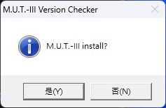

若安裝確認視窗需要使用者操作，請按 `Yes／是`，接著依畫面選擇 `Other` 及 `Install`。UAC 或其他高權限視窗需要由電腦使用者在本機完成操作。本次已完成這些操作並進入 SQL 安裝階段，結果見第 7.1 節。

不要直接執行安裝來源根目錄下的 `BAT\NEW.BAT`，也就是 `C:\MUT-Install\SEW25091\BAT\NEW.BAT`，來繞過入口。此內部批次檔可能清除舊版資料，應由 `MUT3_Install.bat` 負責選擇完整安裝或更新等流程。

## 6. 處理 PowerShell 2.0 檢查

本節分成「查詢系統狀態」與「官方暫時方案」。安裝 PowerShell 7 並不等於恢復 PowerShell 2.0，也不要用偽造登錄值的方式讓檢查通過。

### 6.1 查詢 Windows 是否仍提供可選功能

以系統管理員身分開啟 Windows PowerShell，執行：

```powershell
Get-WindowsOptionalFeature -Online |
    Where-Object { $_.FeatureName -like '*PowerShellV2*' } |
    Select-Object FeatureName, State
```

| 查詢結果 | 下一步 |
| --- | --- |
| 找到 PowerShell 2.0 相關功能，狀態為 Disabled | 依此 Windows 版本的原廠安裝手冊處理可選功能，完成要求的重新開機後再查詢 |
| 找到功能，狀態為 Enabled | 仍需檢查實際引擎版本，並保留安裝器仍報錯的證據 |
| 沒有任何輸出 | 可能是功能已被移除；對照 Windows build 與 Microsoft 官方說明，不能解讀為已啟用 |
| 出現拒絕存取／需要提高權限 | 以系統管理員身分重新查詢 |

### 6.2 查詢 64 位元與 32 位元引擎

下列命令適用於 64 位元 Windows，在 **64 位元 Windows PowerShell** 中逐一執行：

```powershell
& "$env:SystemRoot\System32\WindowsPowerShell\v1.0\powershell.exe" `
    -Version 2 -NoProfile -NonInteractive -Command '$PSVersionTable.PSVersion.ToString()'

& "$env:SystemRoot\SysWOW64\WindowsPowerShell\v1.0\powershell.exe" `
    -Version 2 -NoProfile -NonInteractive -Command '$PSVersionTable.PSVersion.ToString()'
```

`-Version 2` 必須是 `powershell.exe` 後的第一個參數。本次測試若先放 `-NoProfile`，會出現 `-Version` 不被辨識為命令的錯誤，不能將此參數順序造成的錯誤當作引擎狀態。

保存兩次完整輸出。**判斷依據是輸出的實際版本，不是命令是否結束。** 在 PowerShell 2.0 已移除的系統，指定 `-Version 2` 仍可能回退至系統預設引擎；若顯示 `5.1...`，就不能記為 PowerShell 2.0 可用。[Microsoft 官方行為說明](https://support.microsoft.com/en-us/servicing/os/windows/docs/2025/08/powershell-2-0-removal-from-windows)

本機在官方元件載入後重新執行相同命令，結果如下，與修復前一致：

| 架構 | 實際版本輸出 | 結束代碼 | 判讀 |
| --- | --- | --- | --- |
| 64 位元（System32） | `5.1.26100.9444` | `0` | 回退至 PowerShell 5.1，未證明 2.0 可用 |
| 32 位元（SysWOW64） | `5.1.26100.9444` | `0` | 回退至 PowerShell 5.1，未證明 2.0 可用 |

兩者都另外輸出 PowerShell 2.0 已淘汰、改用預設 PowerShell 的訊息。後續已確認官方 DLL 與登錄資料落地，第二輪 SQL 安裝器也接受 PowerShell／.NET 前置條件，但仍不能把這些命令的結束代碼 `0` 解讀為真正使用 2.0 引擎。

### 6.3 功能已移除時：Microsoft 官方暫時方案

**本次已完成官方元件載入，第二輪 SQL 安裝器通過原先的前置檢查，但當時另遇登錄權限錯誤；第三輪處理該權限後，兩個 SQL 安裝與重啟後查詢均通過。** Microsoft 將此作法定位為暫時緩解措施，並不代表 SQL Server 2014 獲得 Windows 11 正式支援。[官方步驟與下載入口](https://support.microsoft.com/en-us/servicing/os/windows/docs/2025/08/powershell-2-0-removal-from-windows)

#### A. 下載官方元件與輔助腳本

1. 確認上一輪受影響的安裝程序已結束；已安裝部分 M.U.T. 元件的電腦，先依第 11 節處理解除安裝與備份。
2. 開啟 Microsoft 官方文章的 **Temporary mitigation** 段落，使用其中的連結下載 `ps2DLC.zip`，放到 `C:\MUT-Install\ps2DLC.zip`。
3. 在 PowerShell 計算雜湊，核對是否為本次審查的版本：

```powershell
Get-FileHash -LiteralPath 'C:\MUT-Install\ps2DLC.zip' -Algorithm SHA256
```

本次下載檔的 SHA-256：

```text
D9812E7BE1F72FF49D73F3179E207AA0000852D9D0EFD92455AD376FAD5D9B7C
```

4. 將 ZIP 完整解壓至 `C:\MUT-Install\ps2DLC`。ZIP 內另有一層 `ps2DLC`，結果應為 `C:\MUT-Install\ps2DLC\ps2DLC\loadGAC.ps1`；保留所有 DLL、資源及登錄檔，不要只取出 `.ps1`。
5. 閱讀本專案的 [Repair-MutPrerequisites.ps1](../scripts/Repair-MutPrerequisites.ps1) 與 [Run-MutRepair.cmd](../scripts/Run-MutRepair.cmd)，將兩個檔案分別複製到 `C:\MUT-Install`。不要改寫 Microsoft 的 `loadGAC.ps1` 或隨附登錄檔。

預期目錄如下；輔助腳本使用這些固定路徑：

```text
C:\MUT-Install\
├─ ps2DLC.zip
├─ Repair-MutPrerequisites.ps1
├─ Run-MutRepair.cmd
└─ ps2DLC\ps2DLC\
   ├─ loadGAC.ps1
   ├─ Binaries\
   ├─ ResourceBinaries\
   └─ regkeysNew\
```

如果雜湊不同、官方檔案缺少或安裝程序仍在執行，輔助腳本會停止。先查明來源或版本差異，不要刪除檢查來強行繼續。

#### B. 以管理員身分執行並判讀結果

1. 在檔案總管對 `C:\MUT-Install\Run-MutRepair.cmd` 按右鍵，選「以系統管理員身分執行」，由使用者完成 UAC。
2. 保持命令視窗開啟。腳本先備份相關設定，再啟用 `.NET Framework 3.5`，接著以 64 位元及 32 位元 Windows PowerShell 分別執行未修改的官方 `loadGAC.ps1`。
3. 若 `NetFx3` 顯示 `DisabledWithPayloadRemoved`，本次流程會透過 Windows Update 下載缺少的內容。下載進度可能暫時不變；以視窗、狀態檔及日誌判斷，不要多開另一輪修復。
4. 官方載入程式會匯入登錄資料，其中包含執行原則。輔助腳本在結束時，將 32／64 位元登錄檢視中的 `Microsoft.PowerShell` 與 `ScriptedDiagnostics` 共四項 `ExecutionPolicy` 恢復原本的存在狀態、型別和值，不用假登錄值繞過檢查。
5. 依視窗顯示的退出碼處理：

| 退出碼 | 意義與下一步 |
| --- | --- |
| `3010` | .NET 需要重新開機；儲存工作並重啟後，再執行同一啟動器 |
| `0` | 前置元件載入步驟結束；仍需審查日誌、設定與實際引擎版本，不能直接宣告 M.U.T. 安裝成功 |
| 其他數字 | 本輪未正常完成，保留視窗與日誌，先處理記錄的錯誤 |

本機狀態檔在 `C:\MUT-Install\repair-status.json`，每輪日誌在 `C:\MUT-Install\repair-logs\<時間戳記>`。若狀態為 `policy-restore-failed`，先依備份還原相關執行原則，不要忽略此錯誤繼續安裝。重新執行 `Get-ExecutionPolicy -List` 及第 6.2 節的版本查詢，保留輸出供比較。

#### C. 官方手動方法與本次驗證

Microsoft 官方步驟是在系統管理員 Windows PowerShell 進入完整解壓資料夾後執行 `loadGAC.ps1`，核心操作為：

```powershell
Set-Location -LiteralPath 'C:\MUT-Install\ps2DLC\ps2DLC'
.\loadGAC.ps1
```

以上只說明官方核心動作；它不會代替本教學的 .NET 檢查、兩種架構處理或執行原則復原。一般讀者請使用上方已實測的輔助流程，避免漏做這些步驟；公司政策若阻擋執行，先保留錯誤並遵循管理政策。

本次修復從 2026-10-10 19:46:29 執行至 19:58:19（台灣時間），核驗結果如下：

| 項目 | 實測結果 |
| --- | --- |
| .NET Framework 3.5 | `DisabledWithPayloadRemoved → Installed／Enabled` |
| .NET 重啟需求 | `RestartNeeded=False`；這只代表本次 .NET 操作，不能代替其他安裝器的重啟要求 |
| 輔助流程退出碼 | `0` |
| 官方載入腳本 | System32、SysWOW64 兩次均退出 `0`，腳本未修改 |
| 載入器錯誤輸出審查 | 以 CP950 解碼後是 `reg.exe` 的成功訊息，未發現元件載入錯誤 |
| 官方來源檔案 | 32／32 檔案雜湊核對通過 |
| GAC 元件核對 | 17／17 組件身分與官方來源相符：15 個共享 MSIL，加上 `pspluginwkr` 的 AMD64 與 x86 版本 |
| PowerShell 引擎登錄資料 | 兩種登錄檢視均有官方 2.0／v2 runtime 資料 |
| 四項執行原則 | 已逐項核對，完整恢復原本的存在狀態、型別及值 |
| `powershell.exe -Version 2` | 兩種架構仍回退至 `5.1.26100.9444`，沒有證明實際使用 2.0 引擎 |

**元件載入成功與 SQL／M.U.T. 安裝成功是不同的驗證項目。** 完成這些檢查後，再從原廠 `MUT3_Install.bat` 重試；不要自行刪改 GAC 或新增假登錄值。

### 6.4 本次實測的 SQL 權限處理與重裝入口

**適用範圍：** 本次相同雜湊的 `SEW25091` 安裝來源、固定英文路徑、`Other／EXP`，以及 SQL Server 2014 SP1 x86 的兩個指定實例。此流程已使本機 SQL 安裝及重啟後資料庫查詢通過；傳統版主畫面仍未完成驗收。它不是供任意 SQL 版本、實例或登錄權限問題使用的修復工具，也不應在已有可用資料庫的電腦上重跑清理。

#### A. 準備本專案的腳本

從本專案根目錄開啟 PowerShell，將 `scripts` 中所有檔案複製到固定位置。先完整解壓安裝包、依第 6.3 節完成前置元件修復與要求的重開機：

```powershell
New-Item -ItemType Directory -Path 'C:\MUT-Install' -Force | Out-Null
Copy-Item -Path '.\scripts\*' -Destination 'C:\MUT-Install'
```

CMD 啟動器會固定進入 `C:\MUT-Install`，**不要只在下載的 GitHub 專案資料夾直接執行**。安裝來源必須位於 `C:\MUT-Install\SEW25091`。各腳本會核對適用條件及必要的檔案雜湊；如顯示檔案與已審查版本不同，先核對下載內容與換行格式，不要刪除雜湊檢查。

| 腳本 | 用途 |
| --- | --- |
| [Run-MutInstallWithSqlAcl.cmd](../scripts/Run-MutInstallWithSqlAcl.cmd) | 從原廠入口開始乾淨安裝，同時監看本輪兩個 SQL 安裝 |
| [Start-MutInstallWithSqlAcl.ps1](../scripts/Start-MutInstallWithSqlAcl.ps1) | 驗證來源、安裝前狀態與本輪錯誤，最多監看 45 分鐘 |
| [Repair-MutSqlLegacyAcl.ps1](../scripts/Repair-MutSqlLegacyAcl.ps1) | 由監看程序呼叫，備份並限定修改各實例的三個登錄鍵權限 |
| [Run-MutCleanRetry.cmd](../scripts/Run-MutCleanRetry.cmd) | 清理已確認失敗的指定 SQL 引擎；通過後啟動上述安裝流程 |
| [Remove-FailedMutSqlInstances.ps1](../scripts/Remove-FailedMutSqlInstances.ps1) | 使用原廠 SQL Setup 移除符合本次失敗特徵的 SQLENGINE |
| [Run-MutVerification.cmd](../scripts/Run-MutVerification.cmd) | 安裝完成並重新開機後，執行唯讀 SQL 驗收 |
| [Verify-MutSqlInstallation.ps1](../scripts/Verify-MutSqlInstallation.ps1) | 查詢服務、SQL 版本、資料庫中繼資料及必要檔案，保存報告 |

#### B. 選擇新安裝或失敗後重裝

| 目前狀態 | 操作 |
| --- | --- |
| 沒有既有 M.U.T. 資料、`MUT3`／`CAESARCOMPDB` 服務或 APP00 設定，且沒有待重啟或安裝程序 | 在檔案總管對 `C:\MUT-Install\Run-MutInstallWithSqlAcl.cmd` 按右鍵，以系統管理員身分執行 |
| 與本次第二輪相同：SQL ERRORLOG 顯示 x86 MDAC 登錄清單 `0x5／0x90` 存取被拒、Setup 要求移除失敗功能 | 先備份資料，完成第 11.1 節的原廠 `UNINST.BAT` 及重開機，再以系統管理員身分執行 `C:\MUT-Install\Run-MutCleanRetry.cmd` |
| 資料庫已有有效資料，或失敗特徵／安裝來源不同 | 保留資料與日誌，先分析差異；不要套用清理流程 |

失敗重裝的 CMD 先核對兩個實例的身分、原廠來源、最後失敗日誌及停止狀態，再逐一執行原廠 SQL Setup 的指定 `SQLENGINE` 移除。若兩個實例已確認不存在，會直接進入安裝前檢查。它不刪除其他實例或手動清理 Windows 的待重啟標記。

**預期畫面與下一步：** UAC 由本機使用者允許；原廠詢問時按 `Yes／是`、選 `Other`、按 `Install`。驅動精靈若出現，依畫面完成 `Next／下一步` 與 `Finish／完成`。輔助程式不會取代這些互動。

若清理顯示退出碼 `3010`，表示需要重啟，本次不會接著重裝。儲存工作並重新開機後，再執行同一個 `Run-MutCleanRetry.cmd`。若出現其他非零退出碼，先檢查 `C:\MUT-Install\sql-instance-removal-status.json` 及它指向的日誌；不要同時另開安裝器。

#### C. 讓原廠 SQL 安裝器自行重試

監看程序只接受**本輪新產生**、來源與設定相符的兩個 SQL 日誌。當辨識到本次已確認的 MDAC `0x5／0x90` 錯誤，且 32 位元參考權限符合預期，才為該實例備份並補上原生 64 位元登錄檢視中三個既有通訊協定鍵的服務 SID `ReadKey／WriteKey` 繼承權限。每個實例最多處理一次；範圍與第三輪實測時間見第 7.7 節。

本次權限變更後，原廠 SQL 安裝器自行重試並通過。監看程序不會替換 SQL 版本、修改服務帳號、控制服務啟停或強制結束安裝器。45 分鐘逾時、再次出現相同錯誤或其他條件不符時，它會停止監看並留下紀錄；原廠安裝程序可能仍在執行，應先檢查現有畫面与日誌。

| 結果 | 判讀與下一步 |
| --- | --- |
| `sql-engines-completed`／監看退出碼 `0` | 兩個 SQL 安裝都曾通過 `Passed` 且服務曾為 `Running`。原廠仍可能正在安裝資料、SE 或驅動；繼續等待整套安裝結束 |
| 非零退出碼 | 查看 `C:\MUT-Install\sql-acl-coordinator-status.json` 及它指向的日誌，不直接開始第二份安裝 |
| 原廠最終完成及重啟提示 | 保存 `InstLog.txt`，儲存工作並重新開機，進入第 8 節驗收 |

變更前 ACL 備份位於 `C:\MUT-Install\sql-acl-repair-logs\<實例-時間戳記>\acl-backup.json`。脚本雖包含 `-Restore` 分支，但本次**未實機測試 ACL 還原**；不要在成功安裝後為了「收尾」撤回 SQL 仍需使用的權限。備份存在也不代表可免除安裝前的系統與資料備份。

## 7. 傳統版、SQL 與 SE 的安裝階段

通過前置檢查後，繼續由原廠入口操作。以下是每一階段應留下的驗證資料，並不表示本機已全部完成：

| 階段 | 操作與預期 | 若失敗 |
| --- | --- | --- |
| 傳統版 M.U.T.-III | 依完整安裝／更新流程完成，保存對話框與結果 | 記錄錯誤發生於哪個元件，不改由內部批次檔強制安裝 |
| SQL Server | 讓原廠安裝流程處理其隨附版本，保存 Setup 結果 | 查閱 SQL Setup 日誌；不直接改裝另一個 SQL 主版本 |
| M.U.T.-III SE | 完成應用程式及資料安裝，保存完成訊息 | 記錄是否只有 SE 完成，不能因此判定傳統版完成 |
| 重新開機 | 儲存工作並依安裝器要求重開機 | 回到相同來源目錄，先確認安裝紀錄與目前狀態，再依原廠提示續行 |

如果任何畫面停住，先查看是否有被其他視窗遮住的提示、UAC 或重新開機要求。不要同時啟動第二份安裝器。

### 7.1 本次實際安裝流程與失敗位置

以下九張是 **使用者在本次本機安裝時提供的實測截圖**，與第 1 節最初提供的參考圖分開標示。圖片以原檔保存，沒有重繪或改動畫面內容。

**步驟 A：選擇 Other，按 Install。** 此畫面對應本次選用的 `EXP` 區域設定。不要選其他地區後卻將結果當作本教學完全相同的測試條件。


**步驟 B：MUT-III System Setup 複製系統檔案。** 本次可進入進度畫面；54% 只是擷取當下的進度，不能當作完整安裝成功。

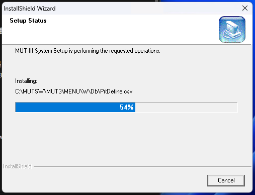

**步驟 C：Service manual viewer system Setup。** 安裝流程接著進入維修手冊檢視器（SMV）階段。

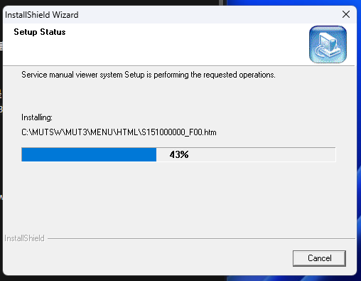

**步驟 D：M.U.T.-III Diagnostic Software 準備與安裝。** InstallShield 先顯示準備畫面，再進入診斷軟體的安裝進度。

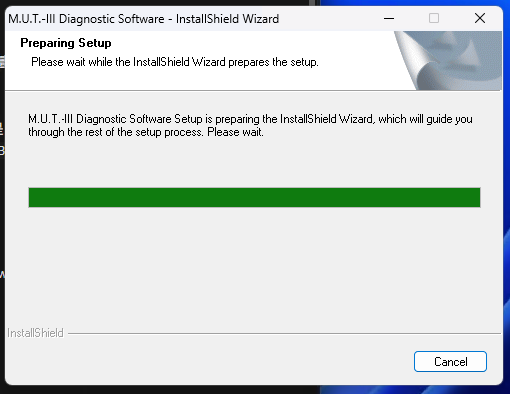

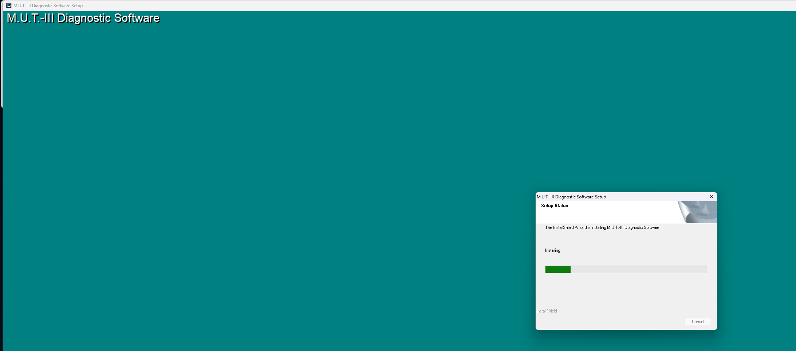

**步驟 E：SQL Server 2014 Express 階段出現 Windows 相容性警告。** 背景安裝器顯示正在安裝 SQL Server 2014 Express 元件；前景 Windows「程式相容性助理」將應用程式列為 `SQL Server Installer`，說明它需要已被取代的 PowerShell 2.0，只提供「深入了解」及「取消」。警告提示了舊依賴問題；後續 SQL 日誌確認啟用 PowerShell V2 功能失敗，不能靠繼續等待解決。


遇到此畫面時，先保存畫面及階段，不要反覆啟動第二份安裝器。「深入了解」可用來取得 Microsoft 的相依元件說明；處理方式與本次效果驗證記錄於第 6 節。此畫面沒有「仍要執行」選項，不能照其他版本 Windows 的教學假設可直接略過。

**步驟 F：資料庫設定失敗。** 本次等待後，診斷軟體安裝器顯示 `Failed to setup databases.`。這是失敗訊息，按「確定」只是在確認訊息，並不能把資料庫修復完成。


SQL Setup 的真實日誌也確認第一輪失敗：啟用 Windows 功能 `MicrosoftWindowsPowerShellV2` 時發生錯誤，導致 `SQLEngine` 失敗，詳見第 7.3 節。共享元件已有部分成功安裝，因此不能將這次失敗理解成「完全未安裝 SQL」。後續已進行原廠解除安裝及官方元件載入；第二輪結果另見第 7.4 節。

**步驟 G：前一個子安裝失敗，套件仍繼續進入 CANBus 資料庫階段。** 本次 `M.U.T.-III Install Package 1/3` 視窗以粗體標出 `Installation of Database for CANBUS Diagnosis`。下方預先列出的 `Installation 1/3 was completed` 是清單中的靜態項目，不能僅憑它出現在視窗中就判定第一包已完成。

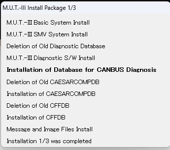

**步驟 H：CANBus 安裝提示找不到執行個體。** `M.U.T.-III CANBus Database Setup` 隨後顯示 `Instance does not exist.`，其 `Cancel` 按鈕為灰色。對照前面的 `SQLEngine` 安裝失敗、`MSSQL$MUT3` 尚未建立，這是上游 SQL 執行個體缺失造成的連帶錯誤，應先處理同一個 SQL／PowerShell 依賴問題。


不要持續按「確定」期待後續套件自行修復資料庫。若取消按鈕停用，需先辨識並停止**本輪受影響的安裝程序**，確認它們已結束，再補依賴與重新測試；不要同時進行修復和仍在執行的資料庫安裝，也不要依 `setup.exe` 名稱全域終止程序。本次後續由使用者執行原廠 `UNINST.BAT`，其清理結果與重試準備見第 11 節。

### 7.2 檢查 M.U.T. 安裝日誌

傳統版安裝紀錄的檢查位置：

```text
C:\MUTSW\InstLog.txt
```

可使用記事本開啟，或在 PowerShell 查看最後 100 行：

```powershell
Get-Content -LiteralPath 'C:\MUTSW\InstLog.txt' -Tail 100
```

找不到日誌也應記錄，不要把「不存在」解讀為無錯誤。公開日誌前請遮蔽帳號、電腦名稱、車輛資訊、產品序號與認證資料。

### 7.3 檢查 SQL 安裝日誌與服務

SQL Server 2014 的常見安裝日誌位置：

```text
C:\Program Files\Microsoft SQL Server\120\Setup Bootstrap\Log\
```

若安裝的是 32 位元元件，也檢查 `C:\Program Files (x86)\Microsoft SQL Server\120\Setup Bootstrap\Log\`。以本機實際出現的位置為準，優先查看 `Summary.txt` 與該次時間戳記目錄的 `Detail.txt`。

本次已確認的日誌為：

```text
C:\Program Files (x86)\Microsoft SQL Server\120\Setup Bootstrap\Log\Summary.txt
```

移除電腦識別資訊後，關鍵結果如下：

| 日誌欄位 | 本次結果 |
| --- | --- |
| Final result | `Failed` |
| Exit code | `-2053898239` |
| 失敗元件 | `SQLEngine` |
| Component error code | `0x85940001` |
| 發生錯誤的 Windows 功能 | `MicrosoftWindowsPowerShellV2` |
| 功能啟用錯誤代碼 | `-2146498548` |

第一輪日誌的關鍵錯誤是啟用 `MicrosoftWindowsPowerShellV2` 失敗。後續按第 6.3 節完成前置元件處理後，第二輪已通過這項檢查；後續失敗原因見下一節。

安裝腳本中指定的 SQL 執行個體為 `MUT3` 與 `CAESARCOMPDB`；第三輪安裝及重啟後已確認兩者可用，詳細結果見第 8.1 節。其他電腦仍須實際檢查，不能只看安裝腳本。可用下列命令查詢對應的資料庫引擎服務，只會讀取狀態；單引號需保留，避免 `$` 被當成變數展開：

```powershell
Get-Service -Name 'MSSQL$MUT3', 'MSSQL$CAESARCOMPDB' |
    Select-Object Name, Status, DisplayName
```

若出現找不到服務的訊息，記錄缺少哪個執行個體，再查閱對應 Setup 結果。服務存在或執行中也不能取代資料庫與應用程式啟動驗證。電腦原本可能已有其他用途的 SQL 服務，不要任意移除其他執行個體。

前次安裝失敗後查到 `SQLBrowser` 為 `Stopped`、`SQLWriter` 為 `Running`，但沒有 `MSSQL$MUT3` 引擎服務。這表示部分共享元件已安裝，不能把 `SQLWriter` 正在執行當成 M.U.T. 資料庫可用。原廠解除安裝後的狀態另見第 11 節。

### 7.4 第二輪：通過前置檢查，資料庫引擎遇到權限錯誤

2026-10-10 20:02:42（台灣時間）已重新從 `C:\MUT-Install\SEW25091\MUT3_Install.bat` 啟動。20:03 的本機截圖顯示 `Install Package 1/3` 正在執行 `M.U.T.-III Diagnostic S/W Install`。

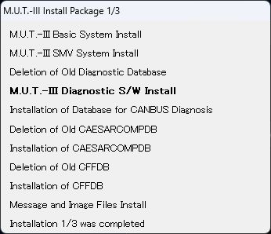

接著於 20:05:19 進入 SQL Server 2014 Express 安裝。本機擷取的進度畫面如下；兩張重試畫面都只能證明進入相應階段，不能單獨證明 SQL 已完成。

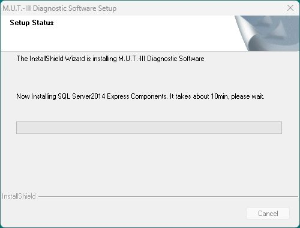

新一輪日誌確認 SQL 接受 PowerShell 2.0 與 .NET 3.5 前置條件，但 `MUT3`、`CAESARCOMPDB` 的資料庫引擎都在設定 MDAC 相容性通訊協定清單時遇到登錄存取被拒。關鍵證據如下：

| 證據 | 第二輪結果 |
| --- | --- |
| 兩個執行個體的 SQL `ERRORLOG` | `17182`，錯誤 `0x5`、狀態 `0x90`；無法設定 MDAC 相容性通訊協定清單，原因為存取被拒 |
| `MUT3` Setup 最終結果 | 20:13:00 記錄 `Failed`，退出代碼 `-2061893607` |
| `MUT3` 元件錯誤 | `0x851A0019`，`Could not find the Database Engine startup handle.` |
| `CAESARCOMPDB` Setup 最終結果 | 20:21:06 記錄 `Failed`，退出代碼同為 `-2061893607` |
| Setup 建議的下一步 | 移除安裝失敗的功能後再重試；不能只等待或反覆啟動程式 |

比對原廠 Setup `Detail` 與實際登錄權限，原生 64 位元檢視的 `Microsoft SQL Server\{執行個體}\MSSQLServer\SuperSocketNetLib` 及其 `Tcp`、`Np` 三處，缺少安裝流程原本應加入的 SQL 服務 SID 讀寫權限項目；32 位元檢視則有對應權限。此差異與兩個執行個體的存取被拒錯誤相符。

**這是第二個已重現的阻礙，不能再把全部錯誤歸因於 PowerShell。** 第二輪當時未執行登錄權限修復；第三輪的處理與驗證進度另見第 7.7 節。第 6.4 節提供這個限定問題的實測輔助程序；第 6.3 節的 PowerShell 前置元件腳本本身不會修復 SQL 登錄權限。

20:33:20 的檢查取得 `C:\MUTSW\InstLog.txt`，其中記錄版本 `PRG23061-03`，並列出下列六項資料庫檔案不存在；兩個 SQL 引擎服務均為 `Stopped`：

```text
CAESARCOMPDB2_data.mdf
CAESARCOMPDB2_data.ldf
CFFDB_data.md
CFFDB_log.ldf
MUTMCB_data.mdf
MUTMCB_log.ldf
```

`CFFDB_data.md` 與 `CAESARCOMPDB2_data.ldf` 都保留原廠檢查器當時的原文，不將它們當作已確認的實際檔名。第三輪實際觀察到的是 `CFFDB_data.mdf` 與 `CAESARCOMPDB2_log.ldf`，見第 7.7 節。`InstLog.txt` 也將系統標為 Windows 10，這是舊檢查器的輸出，本機實際 Windows 11 build 以第 2 節的系統紀錄為準。

### 7.5 原廠驅動程式精靈

第二輪流程在 SQL 失敗後仍繼續至 `Install Package 2/3`，並顯示以下 **本次實測擷取** 的驅動精靈。這再次說明「流程有往下走」不足以判定資料庫成功。

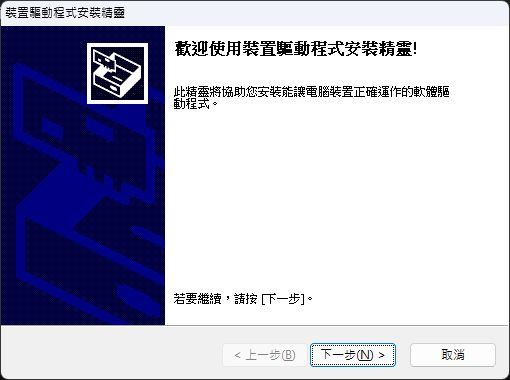

操作位置為桌面的「裝置驅動程式安裝精靈」：按「下一步」，依原廠精靈顯示的結果操作；出現「完成」時，保存結果後按下，讓主安裝流程繼續。精靈等待操作時，不要另外啟動安裝器。

本次使用者按「下一步」後，精靈顯示「成功地在此電腦上安裝了驅動程式」，清單中的 `V.C.I.`、`Mitsubishi Electric Corp...`、`V.C.I.-Lite` 三項均顯示「可使用」。20:30:40（台灣時間）擷取下圖時尚未按「完成」；使用者於 20:31:50 確認按下，精靈關閉後，原廠流程繼續執行第 3 包。

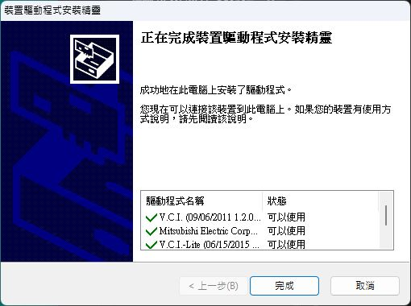

`C:\Windows\DPINST.LOG` 的本輪紀錄確認三個 INF 的 `DriverPackagePreinstallW` 都回傳成功 `0x0`，但 `DriverPackageInstallW` 均回傳 `0xE000020B`：沒有偵測到相符硬體，需等裝置接上後才會套用。準確結論是 **驅動套件已預先載入、精靈顯示可使用，未完成 VCI 實機驗證**；這也不代表 SQL 資料庫或兩套 M.U.T. 程式已通過驗收。

### 7.6 安裝流程結束與重新開機提示

第二輪最後顯示更新／安裝已結束，要求按 `OK`、重新啟動電腦後再退出 DVD。這是原廠流程結束提示，不會抵銷前面的 SQL 失敗及缺少資料庫紀錄。

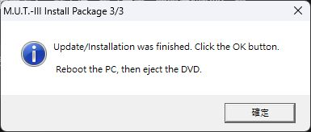

桌面此時已建立 `M.U.T.-3` 與 `M.U.T.-3_SE` 捷徑，兩者皆指向 `C:\MUTSW_SE\MUT3_SE\Temp\MUT3_Launcher.exe`；傳統版參數為 `1`，SE 沒有參數。因此兩個圖示不能證明兩個獨立程式都可用。

當時查到的 `PendingFileRenameOperations` 含失敗的 CANBus 安裝與 InstallShield 暫存檔案。使用者已依提示重新啟動；20:47:49 的唯讀檢查確認 Windows 最後開機時間為 **20:36:49.5**（原為 19:25:29.5），CBS、Windows Update 與檔案更名的待重啟標記均已清除，也沒有 M.U.T.／Setup 安裝程序仍在執行。

重啟後兩個 SQL 引擎服務仍為 `Stopped`，因此重啟沒有解決先前的資料庫失敗。後續已再次執行原廠 `UNINSTALLER\UNINST.BAT`，結果見第 11.1 節。這是套用登錄權限前的第二輪結果，第三輪另見下一節。

### 7.7 第三輪：清理 SQL 後重新安裝

第 11.1 節記錄了兩個失敗 SQL 執行個體的移除結果。Windows 已於 21:20:32.5 重啟；21:33 的安裝前檢查確認沒有待重啟標記、目標 SQL 服務、M.U.T. 目錄或仍在執行的安裝程序，PowerShell 前置元件也維持核驗通過。這些是第三輪啟動前的清理狀態，不代表安裝中的目錄與服務仍應不存在。

第三輪繼續使用未修改的原廠 `MUT3_Install.bat`。使用者於 **21:41:56（台灣時間）** 完成安裝確認，選擇 `Other` 並按 `Install`。21:42 擷取下圖時，流程已進入 `M.U.T.-III Install Package 1/3` 的 SMV 安裝階段：

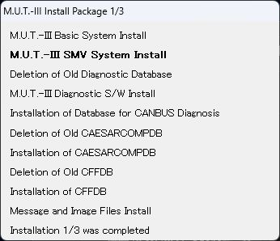

21:42 的畫面只記錄 SQL 前的安裝階段。後續 **21:44:30** 已啟動 `MUT3` 的 SQL Setup，新日誌目錄為 `C:\Program Files (x86)\Microsoft SQL Server\120\Setup Bootstrap\Log\20261010_214430`；監看程序於 **21:44:53** 辨識到本輪日誌。以下是第三輪實際顯示的 SQL 安裝進度：


**21:46:22，`MUT3` 的權限輔助程序結束，退出碼為 `0`，狀態為 `applied-review-required`。** 本次僅對原生 64 位元登錄檢視中的以下三個既有項目，加入 `MUT3` 自身 SQL 服務 SID 的 `ReadKey`／`WriteKey` 權限，繼承旗標為 `ContainerInherit`：

```text
HKLM\SOFTWARE\Microsoft\Microsoft SQL Server\MUT3\MSSQLServer\SuperSocketNetLib
HKLM\SOFTWARE\Microsoft\Microsoft SQL Server\MUT3\MSSQLServer\SuperSocketNetLib\Tcp
HKLM\SOFTWARE\Microsoft\Microsoft SQL Server\MUT3\MSSQLServer\SuperSocketNetLib\Np
```

此步驟未啟動或停止 SQL 服務、未更換服務帳號，也未變更全域登錄權限。變更前備份保存在本機 `C:\MUT-Install\sql-acl-repair-logs\MUT3-20261010-214621-788\acl-backup.json`；**備份已建立不等於復原流程已驗證，本次尚未實測 ACL 還原**。

21:46:55 的 SQL Summary 當時仍為 `Pending`，監看程序記錄 `attempted=true`、`patched=true`、`completed=false`，等待原廠安裝器自動重試。後續 **21:49:47，`20261010_214430` 的 SQL Summary 正式回報 `Passed`**；SQL Engine、Browser、Writer 與 Support 功能均通過。21:50 監看程序已同時觀察到 `Passed` 與 `MUT3` 服務 `Running`，將該實例標記為 `completed=true`。本次保存了這一輪的 Summary 與 ERRORLOG，與第二輪失敗日誌分開。

這次結果確認：套用上述指定權限後，`MUT3` 引擎本輪安裝已通過。**21:50:32** 原廠流程進入 CANBus Database Setup，`MUT3` 服務當時為 `StopPending`，對應原廠流程的停止服務步驟；不能以這個中間狀態直接宣告異常或完成。後續重啟後的 `Running` 狀態與資料庫查詢結果見第 8.1 節。

後續 CANBus 階段已建立 `MUTMCB_data.MDF` 與 `MUTMCB_log.LDF`；當時只確認檔案存在。22:12 的重啟後查詢再確認 `MUTMCB` 為 `ONLINE` 且可存取，尚未進行資料內容或完整性測試。

**21:51:08** 啟動 `CAESARCOMPDB` 安裝，本輪 SQL 日誌目錄為 `20261010_215108`。**21:51:58** 權限輔助程序退出 `0`，將該實例自身服務 SID 的讀寫權限套用至相同範圍的三個原生 64 位元通訊協定登錄項目；其變更前備份為 `C:\MUT-Install\sql-acl-repair-logs\CAESARCOMPDB-20261010-215157-431\acl-backup.json`，還原仍未實測。

21:53 時 `CAESARCOMPDB` 當時仍為 `Pending`，其後原廠自動重試成功：**21:55:19** 的 ERRORLOG 出現 ready 與 recovery complete 訊息，**21:55:22** 的 `20261010_215108` SQL Summary 正式回報 `Passed`。**21:55:24** 監看程序以 `sql-engines-completed`、退出碼 `0` 結束，兩個實例均曾通過 `Passed` 與服務 `Running` 的檢查。

兩個實例套用限定登錄權限後，本輪 SQL 引擎安裝均已通過；這項結果與原廠整套安裝完成仍是不同的驗收項目。**21:55:40** 即時查詢顯示兩個服務皆為 `Stopped`、啟動類型 `Auto`，原廠 `Package 1/3` 仍在資料庫複製及安裝階段。監看程序的完成旗標是先前檢查結果，不能當作服務此刻持續 `Running` 的證明。

**21:56** 另外確認下列資料庫檔案存在；這是安裝期間的檔案層級檢查。資料庫狀態其後已於 22:12 查詢確認，資料內容與完整性仍未測試：

| 實際檔案名稱 | 大小（bytes） |
| --- | ---: |
| `CAESARCOMPDB2_data.mdf` | `125,829,120` |
| `CAESARCOMPDB2_log.ldf` | `15,400,960` |
| `CFFDB_data.mdf` | `10,485,760` |
| `CFFDB_log.ldf` | `3,538,944` |

原廠流程於 **21:57:45** 進入 `Package 2/3`，**21:58:36** 進入 `Package 3/3` 並建立 SE 目錄。本輪未出現新的 DPInst 精靈，`C:\Windows\DPINST.LOG` 最後修改時間仍為 20:31:40；驅動依據仍是第 7.5 節的第二輪預先載入結果，本輪沒有重新完成驅動或 VCI 硬體測試。

**21:59:22，原廠安裝流程完成。** 新的 `C:\MUTSW\InstLog.txt` 長度為 301 bytes，版本記錄為 `PRG23061-03`、診斷軟體 `X5W-520-01`、基礎系統 `1.15.03.31.0`、SMV `1.14.12.19.0`；結尾顯示「問題なし」，第二輪列出的六項缺少資料庫檔案訊息已消失。這是原廠安裝檢查結果；後續資料庫及程式啟動驗收另列於第 8 節，傳統版主畫面尚未通過。


公共桌面已重新建立 `M.U.T.-3` 與 `M.U.T.-3_SE` 捷徑，目標 `C:\MUTSW_SE\MUT3_SE\Temp\MUT3_Launcher.exe` 存在；傳統版參數仍為 `1`，SE 無參數。捷徑共用啟動器，因此必須分別確認各自實際開啟的主畫面。

使用者已儲存工作並於 **22:06:01.5** 重新啟動 Windows；這是第三輪安裝完成後的重啟。SQL 及 SE 的驗收結果見下一節，傳統版啟動仍在調查。已實測的限定權限輔助程序收錄於第 6.4 節，其結果不能代替雙程式驗收；ACL 還原尚未實測。

## 8. 完成後的驗收方式

**兩個圖示只是第一步。** 以下勾選項目反映 2026-10-10 第三輪安裝後的實測結果；尚未勾選的項目仍是完成雙版本驗收的必要條件。

- [x] 原廠完整安裝流程結束，`InstLog.txt` 以「問題なし」結束。
- [x] 桌面出現 `M.U.T.-3` 和 `M.U.T.-3_SE`，捷徑目標存在。
- [x] 安裝完成後重新開機，最後開機時間為 22:06:01.5。
- [x] 重啟後兩個 SQL 服務均為 `Running／Auto`，資料庫中繼資料查詢通過。
- [x] 由 SE 桌面捷徑進入主畫面，確認 `Ver.SEW25091-00` 並保存截圖。
- [x] SE 可進入離線系統選擇畫面，另行記錄無車輛連線時的 VIN 提示。
- [ ] 由傳統版桌面捷徑進入主畫面，確認版本與資料載入結果。
- [ ] 保存傳統版主畫面及版本截圖，完成重啟後雙程式啟動驗收。
- [x] 工具變更的四項 PowerShell 執行原則已按測試前值恢復並核對。

### 8.1 重啟後 SQL 與資料庫檢查

**操作位置：** Windows 檔案總管。確認已依第 6.4 節複製完整腳本後，對 `C:\MUT-Install\Run-MutVerification.cmd` 按右鍵，以系統管理員身分執行。它使用 64 位元 Windows PowerShell 5.1 與本機 Windows 整合驗證，只讀取服務、SQL 中繼資料與檔案狀態，並保存 `InstLog.txt` 的原樣副本，不會啟停 SQL 或修改資料庫。不要以 SQLBrowser、SQLWriter 或單純的 MDF 檔案存在代替此項驗收。

**預期結果：** 退出碼 `0`，最新 `C:\MUT-Install\verification-logs\<時間戳記>\report.json` 中 `Status` 為 `ReadOnlyChecksPassed`、`Findings` 為空陣列。另核對報告中的最後開機時間確實晚於安裝完成；`AfterReboot` 標籤本身不能證明已經重啟。

本次於 **22:12:04–22:12:06**，透過本機 shared memory（`lpc:.\MUT3`、`lpc:.\CAESARCOMPDB`）完成唯讀查詢，結果如下：

| 檢查 | 重啟後結果 |
| --- | --- |
| `MSSQL$MUT3`、`MSSQL$CAESARCOMPDB` | 均為 `Running`，啟動類型 `Auto` |
| 兩個引擎版本 | SQL Server 2014 Express SP1，`12.0.4100.1`，x86 |
| `MUT3` 可見資料庫 | 46／46 為 `ONLINE`，`HAS_DBACCESS=1`；數量包含系統資料庫 |
| `CAESARCOMPDB` 可見資料庫 | 6／6 為 `ONLINE`，`HAS_DBACCESS=1`；數量包含系統資料庫 |
| 必要資料庫 | `MUTMCB`、`CAESARCOMPDB2`、`CFFDB` 均 `ONLINE／MULTI_USER`，查詢帳號可存取 |
| 六個必要 MDF／LDF | 均存在且大小非零 |
| 安裝檢查紀錄 | 保留 21:59:22 的原始 `InstLog.txt`，結尾為「問題なし」 |
| 安裝程序與重啟狀態 | 未發現仍在執行的安裝程序；22:09 檢查無待重啟標記 |
| 唯讀檢查總結果 | `ReadOnlyChecksPassed`，異常項目清單為空 |

此查詢使用管理員的 Windows 整合驗證，確認的是該帳號的存取能力及當下資料庫狀態；不是應用程式所有 SQL 操作、資料內容完整性或車輛功能測試。原始驗證報告留在本機 `C:\MUT-Install\verification-logs\20261010-221204-c12acea4\report.json`，未公開到本專案。

**若失敗：** 記錄缺少的服務、無法連線的實例或非 `ONLINE` 的資料庫名稱，回查該實例的 Setup Summary 與 ERRORLOG。不要因 SE 主畫面可開啟，就略過傳統版依賴的 SQL 結果。

### 8.2 SE 主畫面、版本與離線資料選單

**操作位置：** Windows 桌面的 `M.U.T.-3_SE` 捷徑。本次於 **22:16:36** 啟動；如首次啟動顯示使用條款，閱讀並依畫面完成確認，再進入主畫面。

**預期畫面：** `MUT3-SE` 主畫面可見 `SMV`、`STV`、`Configuration` 等按鈕，底部顯示 **`Ver.SEW25091-00`**。以下是本次重啟後實測截圖：


在沒有連接 VCI／車輛的測試環境，按 `STV` 後，本次出現 **Chassis No./VIN 無法讀取** 的提示。先保存訊息，再確認關閉對話框。本次沒有嘗試診斷、編程或寫入操作。


確認提示後，本次可進入 `System select`，看到 `EXP`、`MITSUBISHI` 以及 `GG2W／2015／OUTLANDER-PHEV` 選項，VIN 空白。**這些是當時畫面顯示的選擇值，不是讀取到的實車資訊。** 此步驟只證明離線介面及資料選單可載入。


**若失敗：** 若主畫面未出現、版本不同，或出現資料庫／檔案載入錯誤，保存原文與截圖，回查安裝紀錄；不要把所有錯誤都歸因於沒有連接 VCI。即使 VIN 提示與本次相同，也不能據此確認車輛連線功能正常。

### 8.3 傳統版仍待完成的驗收

**操作位置：** Windows 桌面的 `M.U.T.-3` 捷徑。本次重啟後已啟動，並完成首次條款確認，但按啟動後 launcher 結束，尚未出現傳統版主畫面。此現象仍在調查，不能以 `InstLog.txt` 的 `PRG23061-03` 代替主畫面的版本驗證，也不能將 SE 的可用狀態套用至傳統版。

完成條件是由該捷徑進入傳統版主畫面、確認實際版本與資料載入結果，並保存截圖。若重現相同現象，先保存啟動時間與安裝／應用程式錯誤紀錄，再定位啟動流程；不要反覆重裝已通過查詢的 SQL 或直接宣告雙版本成功。

本次沒有連接實車或 VCI。即使兩個程式最後都可啟動，也只代表指定 Windows build 的程式啟動驗證，不能推論診斷、編程或寫入車輛功能已通過。

## 9. 本機實測結果

以下只登錄本次實際執行過的結果；待測項目不以推測補齊。

| 項目 | 狀態 | 證據／備註 |
| --- | --- | --- |
| ZIP 大小與 SHA-256 | 已記錄 | 見第 2 節 |
| ZIP 內容 CRC | 已通過 | 所有封存項目完整性檢查通過 |
| Windows build 與 DisplayVersion | 已記錄 | `26300.9457`／`26H2` |
| 完整解壓 | 已完成 | `C:\MUT-Install\SEW25091` |
| 原廠入口與 UAC | 已完成操作 | 使用者允許 UAC，選擇 `Other → Install` |
| 基礎系統、SMV、診斷軟體 | 第三輪原廠檢查已通過 | 21:59:22 `InstLog.txt` 列出版本並以「問題なし」結束；傳統版主畫面仍未通過驗收 |
| PowerShell 阻礙重現 | 已重現，位於 SQL 階段 | Windows 程式相容性助理警告 `SQL Server Installer`；與最初參考圖的 M.U.T. 入口提示不同 |
| PowerShell 2.0 可選功能 | 修復前完成部分查詢 | WMI 清單未列出 V2；當時未執行 DISM 管理員查詢 |
| .NET Framework 3.5（NetFx3） | 已啟用 | `Installed／Enabled`，本次 `RestartNeeded=False` |
| 32／64 位元引擎實際版本 | 載入後仍回退 | 均輸出 `5.1.26100.9444`、結束代碼 `0`；未證明 2.0 引擎可執行 |
| 官方 PowerShell 2.0 暫時方案 | 元件載入與核驗完成 | 兩架構 loader 退出 `0`；17／17 組件及官方登錄資料已核對 |
| 傳統版安裝／啟動／版本 | 原廠檢查通過，主畫面未出現 | `InstLog.txt` 記錄 `PRG23061-03` 與「問題なし」；重啟後 launcher 完成條款確認後結束，尚無主畫面或實際版本截圖 |
| SQL 安裝與服務 | 安裝與重啟後查詢均通過 | 兩個 SQL Summary 均 `Passed`；22:12 兩服务均 `Running／Auto`，實際版本 `12.0.4100.1` |
| SQL 可見資料庫狀態 | 唯讀中繼資料查詢通過 | `MUT3` 46／46、`CAESARCOMPDB` 6／6 均 `ONLINE` 且查詢帳號可存取，數量包含系統資料庫 |
| CANBus 與其他必要資料庫 | 重啟後可用狀態通過 | `MUTMCB`、`CAESARCOMPDB2`、`CFFDB` 均 `ONLINE／MULTI_USER` 且可存取，六個 MDF／LDF 均存在且非零；內容及完整性未測 |
| 第一次原廠解除安裝 | 已執行並檢查清理結果 | 19:33 檢查專用目錄、執行個體及 M.U.T. 設定已移除；當時共享元件保留 |
| 第一輪解除安裝後重新開機 | 當時未觀察到 | 原廠最後 INI 設定要求重啟；第二輪後的實際重啟另列於下方 |
| 第二輪原廠安裝 | 流程結束，驗收未通過 | 已顯示重啟提示，SQL 失敗與缺少資料庫問題仍在 |
| SQL 登錄權限修復 | 兩實例套用後，引擎安裝均通過 | `MUT3` 於 21:46:22、`CAESARCOMPDB` 於 21:51:58 各自加入限定三鍵的服務 SID 讀寫權限，後續 SQL 均 `Passed`；兩者均有變更前備份，還原未實測 |
| 裝置驅動程式 | 第二輪套件已預先載入 | 第三輪無新 DPInst 紀錄；仍沿用前次預載入證據，未做 VCI 實機驗證 |
| 桌面兩個捷徑 | 第三輪已重建，目標存在 | 同一 launcher、不同參數；尚非啟動成功證據 |
| 第二輪後重新開機 | 已確認 | 最後開機時間 20:36:49.5；20:47 檢查待重啟標記已清除，無安裝程序仍在執行 |
| 第二次原廠解除安裝 | 已走到重啟提示 | 20:55–20:57 移除 M.U.T. 目錄及 APP00；兩 SQL 引擎及 Agent 服務仍 `Stopped` |
| 第二次解除後前置元件 | 核驗通過 | 17／17 GAC 元件與四項執行原則再次通過檢查 |
| 第二次解除後重新開機 | 已確認 | 21:02:09.5 重啟；21:07 檢查待重啟標記已清空，無安裝程序 |
| 失敗 SQL 功能移除 | 兩個執行個體均成功 | 原廠 SQL Setup 均 `Passed`／exit `0`；服務與兩個登錄檢視的實例映射均消失 |
| SQL 移除後重新開機 | 已確認 | 21:20:32.5 重啟；21:33 核對 `PendingFileRenameOperations`、CBS／Windows Update 重啟標記已清空 |
| 第三次 M.U.T. 安裝及權限處理 | 原廠流程完成，SQL 及 SE 通過驗收 | 21:59:22 原廠檢查「問題なし」；重啟後 SQL 查詢与 SE 啟動通過，傳統版仍待確認 |
| 第三輪完成後重新開機 | 已確認 | 最後開機時間 22:06:01.5；22:09 檢查無待重啟標記或安裝程序 |
| SE 安裝／啟動／版本 | 重啟後主畫面及版本已確認 | 22:16:36 由 SE 桌面捷徑啟動，主畫面顯示 `Ver.SEW25091-00`，見第 8.2 節實測圖片 |
| SE 離線系統選擇 | 可載入，未連接車輛 | 確認 VIN 無法讀取提示後可進入 `System select`；車型值不是實車讀取結果 |
| 重開機後雙程式啟動 | 尚未全部通過 | SE 通過；傳統版尚無主畫面，不能記為完整成功 |
| 執行原則恢復 | 已完成核對 | 32／64 位元檢視下四項值，均按原始存在狀態、型別和值恢復 |
| VCI／車輛連線 | 未測試 | 本次範圍外 |

## 10. 常見問題

| 現象 | 判斷與處理 |
| --- | --- |
| Windows 功能中找不到 PowerShell 2.0 | 新版 Windows 可能已移除，依第 6 節核對 build 與官方說明 |
| 已裝 PowerShell 7，安裝器仍顯示缺少 2.0 | 兩者不是同一個引擎；不要把安裝 7 當作此依賴的解法 |
| `-Version 2` 指令成功，但輸出 `5.1...` | 代表實際執行的是 5.1，不能記為 2.0 已恢復 |
| Windows 程式相容性助理警告 SQL Server Installer | 本次已重現；它發生於 SQL 元件階段，依第 6 節辨識依賴，見第 7.1 節圖片 |
| `Failed to setup databases.` | 本次在 SQL 依賴安裝失敗後出現，代表資料庫設定失敗；不是按「確定」即可修復 |
| CANBus 顯示 `Instance does not exist.` | 本次為 SQL 引擎安裝失敗後的連帶結果；先停止本輪受影響的安裝流程，再修復依賴 |
| Package 1/3 視窗底部有 `Installation 1/3 was completed` | 這是進度清單預先列出的項目，第一輪停在 CANBus 時也會出現，不能把清單文字當成功證據 |
| 錯誤後 Cancel 變成灰色 | 不要反覆按「確定」或多開安裝器；先確認本輪程序並停止，避免全域終止同名程序 |
| 桌面有兩個圖示，其中一個無法啟動 | 回查相應程式、資料庫與安裝日誌，屬於未完成雙版本驗收；本次 SE 已可啟動，傳統版尚未出現主畫面 |
| SE 按 `STV` 後無法讀取 Chassis No./VIN | 本次未連接 VCI／車輛時已出現；確認提示後可載入離線選單，但不代表車輛連線或診斷測試通過 |
| 按「是」後只完成 SE | 記錄為 SE 單獨安裝；若仍需傳統版，先處理完整安裝的前置條件 |
| 找不到 `MUT3_Install.bat` | 確認 ZIP 是否完整解壓及是否多了一層 `SEW25091` |
| 找不到 `InstLog.txt` | 記錄實際完成到的階段，安裝可能尚未開始建立該目錄 |
| SQL Setup 失敗 | 保存該輪 `Summary.txt`／`Detail.txt`；Windows 11 不在 SQL Server 2014 支援清單 |
| `17182`／`0x5`／`0x90`，MDAC 通訊協定清單存取被拒 | 第二輪兩個 SQL 執行個體已重現；第三輪兩者套用指定服務 SID 權限後，SQL 安裝與重啟後查詢均通過；傳統版啟動仍待確認，暫不提供通用修復指令 |
| `0x851A0019`、找不到 Database Engine startup handle | 本次 `MUT3` 因上述啟動錯誤失敗；保留 `ERRORLOG`，不能僅憑此概括訊息判定 PowerShell 仍缺少 |
| 安裝中斷或需要重開機 | 先保存日誌與畫面，再依原廠流程續行；不要多開安裝器 |

## 11. 復原與解除安裝

### 11.1 兩次原廠解除安裝與清理確認

使用者已自行執行原廠解除安裝入口：

```text
C:\MUT-Install\SEW25091\UNINSTALLER\UNINST.BAT
```

如需在其他電腦重做此流程，應先備份需要保留的診斷資料，參照隨附解除安裝手冊，結束受影響的安裝流程，再以系統管理員身分執行此入口。不要把解除安裝用作無損更新，也不要自行刪除所有 SQL 元件。

第一次解除安裝後，2026-10-10 19:33（台灣時間）的唯讀檢查結果如下：

| 檢查項目 | 解除安裝後結果 |
| --- | --- |
| M.U.T. 安裝／解除安裝程序 | 未發現仍在執行 |
| `C:\MUTSW`、`C:\MUTSW_SE` | 已不存在 |
| SQL `MUT3`、`CAESARCOMPDB` 專用目錄、服務及執行個體登錄 | 已不存在 |
| M.U.T. 的 `MMC\APP00` 登錄設定 | 已不存在 |
| 共用 SQL Server 2014、ODBC、Native Client 元件 | 仍保留 |
| SQLWriter、SQLBrowser 共用服務 | 仍保留 |
| 常見重新開機待處理標記 | 未發現；不等於已完成重開機 |

第一次解除安裝最後的 INI 設定要求重新開機，當時沒有觀察到實際重啟。後續第二輪安裝後，已確認於 20:36:49.5 重新開機，紀錄見第 7.6 節。

這些結果證明本次 M.U.T. 專用元件的清理狀態，**不等於整台 Windows 已還原成安裝前**。保留的共用 SQL 元件可能供其他程式使用，不應為了「清乾淨」而一併移除。

第二次解除安裝由使用者在確認視窗按 `Yes` 後執行：

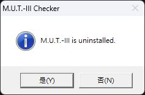

20:55–20:57，流程走到 `Package 3/3` 的重啟提示：

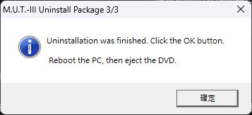

| 第二次解除安裝後檢查 | 結果 |
| --- | --- |
| M.U.T. 目錄與設定 | `C:\MUTSW`、`C:\MUTSW_SE`、`MMC\APP00` 已不存在 |
| SQL 執行個體 | `MSSQL$MUT3`、`MSSQL$CAESARCOMPDB` 及對應兩個 SQL Agent 服務仍存在，狀態均為 `Stopped` |
| PowerShell 前置元件 | 卸載後再次核驗，17／17 GAC 元件與四項執行原則均通過 |
| 當時重新開機需求 | 新增 `PendingFileRenameOperations`；其後已於 21:02:09.5 重啟 |

這次原廠解除安裝沒有移除殘留的 SQL 執行個體。21:02:09.5 重啟後，21:07 再次確認沒有待重啟標記、M.U.T. 目錄或安裝程序，才執行指定 SQL 功能的移除。

**21:08–21:10 SQL 清理實測：** 使用安裝包中的 SQL Server 2014 SP1 `SETUP.EXE`，每次只指定一個已確認安裝失敗的執行個體，參數為 `/Q /ACTION=Uninstall /FEATURES=SQLENGINE /INSTANCENAME=MUT3`，第二個為 `/INSTANCENAME=CAESARCOMPDB`。這是本機清理紀錄，不能套用於仍有有效診斷資料或用途不明的其他執行個體。[Microsoft 卸載參數說明](https://learn.microsoft.com/en-us/sql/database-engine/install-windows/install-sql-server-from-the-command-prompt#uninstall-parameters)

| 本輪檢查 | 實際結果 |
| --- | --- |
| `MUT3` | `20261010_210817` 的 SQL Summary 為 `Passed`，Setup exit `0` |
| `CAESARCOMPDB` | `20261010_210845` 的 SQL Summary 為 `Passed`，Setup exit `0` |
| 服務及實例登錄 | 兩個引擎與 Agent 服務均消失；32／64 位元檢視的 instance mapping 均消失 |
| 共用元件 | 未額外指定共用功能移除，但 SQL Setup 自行管理相依元件；本輪後 `SQLBrowser`、`SQLWriter` 服務也已不存在 |
| 待重新開機 | Windows Installer 留下 `C:\Config.Msi\*.rbf` 待刪檔案；輔助流程回 `3010`，未啟動 M.U.T. 重裝 |
| 前置元件再次核驗 | SQL 移除後仍為 17／17 GAC 組件及四項執行原則核對通過，零異常 |

後續已於 21:20:32.5 重新啟動 Windows；21:33 的安裝前檢查確認上述待處理標記均清空，兩個 SQL 服務及 M.U.T. 目錄不存在，無安裝程序仍在執行。其他電腦也應完成所需重啟並核對狀態，不可手動刪除重啟標記來跳過檢查。其後第三輪已於 21:41:56 開始，兩個實例各自套用指定權限後 SQL 安裝均通過，原廠流程於 21:59:22 完成，並於 **22:06:01.5 再次重啟**。這次安裝完成後的 SQL 及 SE 驗收通過，傳統版主畫面仍待確認，详見第 8 節。21:20 的重啟屬於安裝前清理，與 22:06 的安裝後重啟分開記錄。

### 11.2 補齊依賴後重試

1. 保留這輪 SQL Setup 日誌和錯誤截圖，以便比對重試是否解決同一個問題。
2. 依第 6 節處理依賴，完成要求的重新開機，記錄 32／64 位元引擎實際版本及執行原則。維修程序出現 UAC 或正常結束都不能單獨證明問題已解決。
3. 確認沒有先前的安裝／解除安裝程序仍在執行，從原廠入口重裝：`C:\MUT-Install\SEW25091\MUT3_Install.bat`。
4. 重試仍使用 `Other／EXP`，比對 SQL 新日誌、`MUT3` 執行個體與資料庫結果，再完成第 8 節的雙程式及重啟驗收。

目前已完成第 6.3 節的前置元件載入與核驗，第二輪 SQL 也通過原先的依賴檢查，但引擎在 MDAC 登錄存取階段失敗。依 SQL Setup 提示，失敗功能已由原廠 SQL Setup 移除，安裝前重啟及清理檢查也已完成；第三輪兩個實例套用指定權限後，引擎安裝均通過，原廠 M.U.T. 檢查以「問題なし」結束。安裝後已重啟，兩個 SQL 的可用狀態與 SE 主畫面／版本已驗證；傳統版主畫面尚未通過，因此目前仍不是雙版本完整成功教學。

### 11.3 復原範圍與限制

1. **應用程式與資料庫**：先備份需要保留的資料，再參照安裝包中的 `M.U.T.-3_Uninstallation_Manual(SEW25091).pdf`。只有確認為本次新增且專供 M.U.T. 使用的元件，才應納入移除範圍。
2. **PowerShell 執行原則**：恢復第 3.2 節記錄的原值；對照恢復前後的 `Get-ExecutionPolicy -List`。
3. **官方暫時安裝的 PowerShell 2.0 組件**：M.U.T. 的 `UNINST.BAT` 不能當作 Microsoft GAC 組件的完整復原工具；刪除 `ps2DLC.zip` 或解壓目錄也不等同移除系統組件。沒有經驗證的自動卸載流程時，完整回復應使用安裝前的系統備份，不提供猜測性的 GAC／登錄檔刪除指令。
4. **其他 SQL 執行個體**：保留其他軟體使用的服務和資料庫，不因名稱包含 SQL 就一併刪除。

## 12. GitHub 文件與圖片

```text
README.md
.gitignore
scripts/
├─ Repair-MutPrerequisites.ps1
└─ Run-MutRepair.cmd
docs/
└─ images/
   ├─ reference-powershell-error.png
   ├─ reference-desktop-icons.png
   ├─ 01-install-confirm.jpg
   ├─ 02-select-other.png
   ├─ 03-basic-system-progress.png
   ├─ 04-service-manual-progress.png
   ├─ 05-diagnostic-preparing.png
   ├─ 06-diagnostic-progress.png
   ├─ 07-sql-pca-powershell-error.png
   ├─ 08-database-setup-failed.png
   ├─ 09-package1-canbus-stage.png
   ├─ 10-canbus-instance-missing.png
   ├─ 11-retry-package1.jpg
   ├─ 12-retry-sql-progress.jpg
   ├─ 13-driver-welcome.jpg
   ├─ 14-driver-ready.jpg
   ├─ 15-restart-prompt.jpg
   ├─ 16-uninstall-confirm.jpg
   ├─ 17-uninstall-restart.jpg
   ├─ 18-third-install-package1.jpg
   ├─ 19-third-sql-progress.jpg
   ├─ 20-third-install-finished.jpg
   ├─ 21-se-main-version.jpg
   ├─ 22-se-no-vehicle.jpg
   └─ 23-se-system-select.jpg
```

圖片檔名前綴 `reference-` 表示使用者最初提供的參考圖。`01-` 是本次入口確認截圖，`02-` 至 `10-` 是使用者在第一輪實測時提供的進度與錯誤畫面，`11-` 至 `15-` 是前置元件載入後的第二輪重試截圖，`16-`、`17-` 是後續第二次原廠解除安裝截圖，`18-`、`19-` 是第三輪安裝進度，`20-` 是第三輪原廠完成及重啟提示。`21-` 至 `23-` 是 22:06 重啟後實際操作取得的 SE 主畫面、無車輛連線提示與離線選單。各圖片保留原始 PNG／JPEG 格式，標明對應階段與結果，不會把參考桌面圖當作本機成功證據。

`.gitignore` 已排除安裝包、可執行安裝檔、解壓目錄、原始日誌與暫存資料。提交前仍應檢查檔案清單，避免把約 1.87 GB 的 ZIP 或含個人資料的日誌放入版本庫。本歷史快照撰寫時尚未發布；目前版本與公開狀態以儲存庫首頁為準。

## 13. 參考資料

- [Microsoft Support：PowerShell 2.0 removal from Windows（KB 5065506）](https://support.microsoft.com/en-us/servicing/os/windows/docs/2025/08/powershell-2-0-removal-from-windows)
- [Microsoft Learn：Version requirements for SQL Server in Windows operating system](https://learn.microsoft.com/en-us/troubleshoot/sql/database-engine/install/windows/use-sql-server-in-windows)
- 隨附原廠安裝手冊：`M.U.T.-3_Update_Installation_Manual(SEW25091).pdf`
- 隨附原廠解除安裝手冊：`M.U.T.-3_Uninstallation_Manual(SEW25091).pdf`
