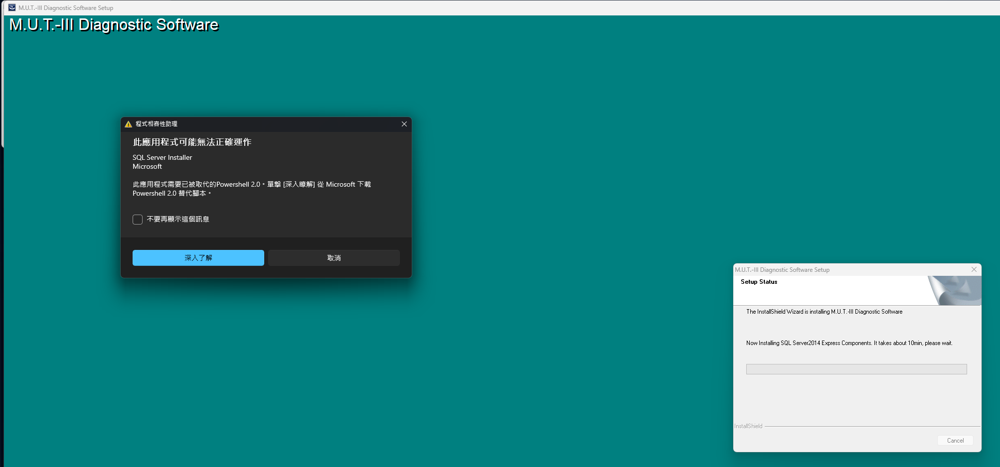
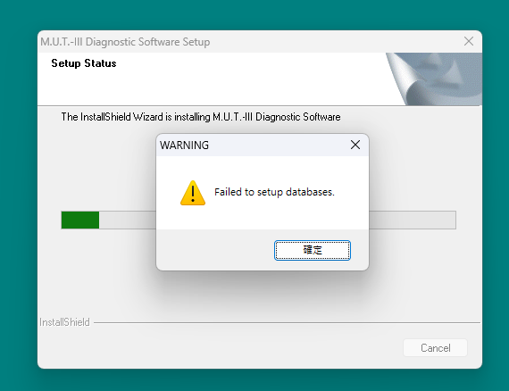
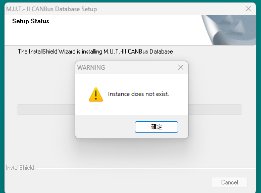
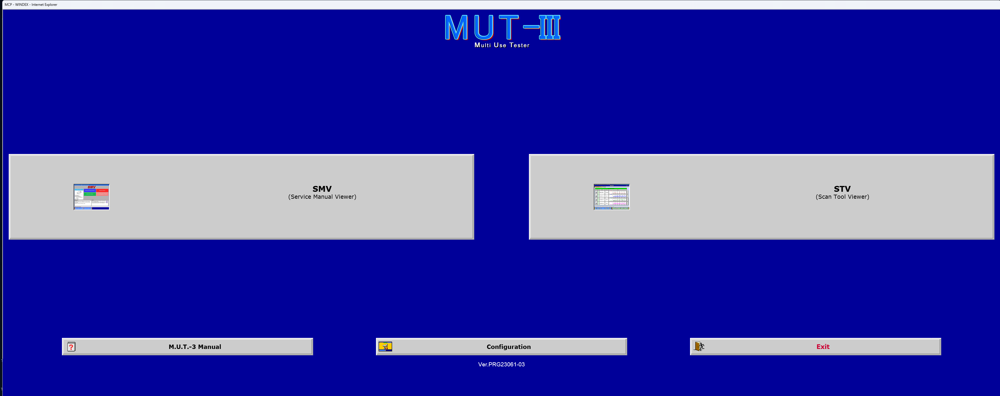
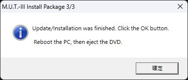
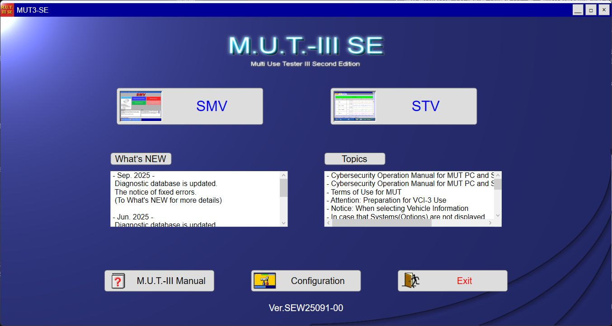

# SEW25091：Windows 11 安裝失敗原因與修復報告

本報告記錄 2026-10-10 在本機執行的安裝、失敗、修復與驗收。結果為 **M.U.T.-3 傳統版 `PRG23061-03` 與 M.U.T.-3 SE `SEW25091-00` 均可開啟，重啟後的 SQL 服務及必要資料庫查詢通過**。使用方式見 [README](../README.md)。

原本的問題不是單一錯誤：先是舊 PowerShell 相依元件，再是 SQL Server 2014 的登錄存取權限，失敗後還有 SQL 殘留與待重啟操作；完成安裝後，傳統版另需要使用者選定 `.js` 開啟方式。本報告區分這些階段，避免把後續所有失敗都誤認為 PowerShell 2.0 沒裝好。

## 1. 實測條件與結論邊界

| 項目 | 本次記錄 |
| --- | --- |
| 日期與時區 | 2026-10-10，Asia/Taipei |
| 作業系統 | Windows 11 Pro x64，build `26300.9457`，DisplayVersion `26H2`，依本機讀值 |
| 安裝包 | `SEW25091.zip`，`1,865,952,877` bytes |
| 安裝包 SHA-256 | `1B1740A1834B0AF447A17BFFB2A220671728FBC9C8CB851C5F01859912427D03` |
| 安裝方式 | 完整解壓至 `C:\MUT-Install\SEW25091`，保留原廠入口及安裝順序 |
| 地區 | `Other`／`EXP` |
| 原廠 SQL | SQL Server 2014 Express SP1 x86，`12.0.4100.1`，未替換版本 |
| 目標執行個體 | `MUT3`、`CAESARCOMPDB` |
| 完整安裝結束 | 21:59:22，原廠安裝檢查「問題なし」 |
| 安裝後實際開機 | 22:06:01.5 |
| SQL 驗收 | 22:12:04–22:12:06，本機唯讀查詢通過 |
| 程式驗收 | 重啟後確認兩個主畫面與版本；傳統版完成 Script Host → Always 選擇 |

**「本機可以啟動」不等於「Microsoft 官方支援」。** SQL Server 2014 在 Microsoft 的 Windows 11 相容性表中列為不支援；本次修復是這個安裝包與這台電腦的實測結果，不能推廣為所有 Windows 11 版本都受支援。[Microsoft SQL／Windows 相容性表](https://learn.microsoft.com/en-us/troubleshoot/sql/database-engine/install/windows/use-sql-server-in-windows)

本次沒有測試 VCI、實車診斷、編程、寫入、其他 Windows build 或地區，也沒有執行資料庫完整性檢查。SE 離線車型選單能載入，不表示已讀到實車 VIN。

## 2. 問題一：SQL 安裝階段提示 PowerShell 2.0

**症狀。** 第一次原廠安裝進入 SQL Server 2014 Express Components 時，Windows「程式相容性助理」指出需要已被取代的 PowerShell 2.0。稍後出現 `Failed to setup databases.`。



**證據與原因。** 新版 Windows 11 已移除舊 PowerShell 元件，而原廠附帶的舊 SQL 安裝程式仍檢查該相依條件。Microsoft 說明移除自 2025 年 8 月的 Windows 11 24H2 更新開始，並提供暫時補充套件。這與本機的安裝階段和訊息一致。[官方移除說明與暫時方案](https://support.microsoft.com/en-us/servicing/os/windows/docs/2025/08/powershell-2-0-removal-from-windows)

**如何處理。** 啟用 NetFx3，從 Microsoft 官方來源取得 `ps2DLC.zip`，核對固定 SHA-256 後完整解壓。以 64 位元及 32 位元 Windows PowerShell 分別執行原始 `loadGAC.ps1`；操作前保存它會涉及的四項 `ExecutionPolicy` 登錄值，結束後恢復原始存在狀態、型別及值。

**套件來源與備份。** 專案根目錄收錄本次使用的 [ps2DLC.zip 原檔備份](../ps2DLC.zip)，`5,916,333` bytes（`5.642 MiB`），沒有重新壓縮或修改。原始來源為 [Microsoft 官方下載位置](https://download.microsoft.com/download/2b37839b-e146-465a-a78c-c9066609c553/ps2DLC.zip)，用途見 [官方暫時方案](https://support.microsoft.com/en-us/servicing/os/windows/docs/2025/08/powershell-2-0-removal-from-windows)。這是 Microsoft 第三方套件，本專案不將其宣稱為開源，也不替它新增授權。新入口先核對 `C:\MUT-Install\ps2DLC.zip` 快取；不存在才使用專案根目錄備份，兩處都不存在才從官方下載。每一路徑都以以下固定雜湊核對；已有檔案雜湊不符時停止。NetFx3 仍可能需要 Windows Update，附帶此 ZIP 不代表全程離線。

```text
ps2DLC.zip SHA-256
D9812E7BE1F72FF49D73F3179E207AA0000852D9D0EFD92455AD376FAD5D9B7C
```

**如何驗證。** 本機 NetFx3 已啟用、兩架構載入器退出碼皆為 `0`，17／17 GAC 組件身分與來源相符，四項執行原則恢復。後續 SQL 安裝日誌已通過原本的 PowerShell／.NET 前置檢查，錯誤轉為下一節的 SQL 引擎權限問題。

特別核對了實際 PowerShell 版本：即使用 `-Version 2`，本機仍提示回退並輸出 **`5.1.26100.9444`**。所以本報告只說「官方相依元件方案讓安裝前置檢查通過」，**不宣稱恢復了可執行的 PowerShell 2.0 引擎**。Microsoft 亦說明新版 Windows 可能將這個版本要求回退到預設 5.1。[官方回退說明](https://support.microsoft.com/en-us/servicing/os/windows/docs/2025/08/powershell-2-0-removal-from-windows)

## 3. 問題二：SQL 引擎啟動時無法存取 MDAC 登錄鍵

**症狀。** 前置元件處理後，SQL 引擎仍無法啟動。Setup 摘要包括 `0x851A0019`／`Could not find the Database Engine startup handle.`。只看這個摘要無法判定原因，需要繼續讀 `ERRORLOG`。

**證據與原因。** 本機兩個指定 SQL 實例的 `ERRORLOG` 均出現 `17182`、錯誤 `0x5`、狀態 `0x90`，指出 MDAC 相容性通訊協定清單設定遭拒絕存取。比對兩種登錄檢視後，確認本輪需要的是指定 SQL 服務 SID 對原生 64 位元通訊協定鍵的讀寫權限。這是本機日誌與 ACL 比對得到的結論，不是僅憑「Windows 11 不支援」猜測的通用原因。

**如何處理。** 保留原廠 SQL 版本、帳號及 Setup 流程。監控本輪新產生的 SQL 日誌，只有來源與設定相符，且出現上述特定錯誤時，才先備份並加入**該實例自己的服務 SID** `ReadKey／WriteKey` 權限，使用 `ContainerInherit`。每實例最多套用一次，範圍僅限 Registry64 的三個既有登錄鍵：

```text
HKLM\SOFTWARE\Microsoft\Microsoft SQL Server\<instance>\MSSQLServer\SuperSocketNetLib
HKLM\SOFTWARE\Microsoft\Microsoft SQL Server\<instance>\MSSQLServer\SuperSocketNetLib\Tcp
HKLM\SOFTWARE\Microsoft\Microsoft SQL Server\<instance>\MSSQLServer\SuperSocketNetLib\Np
```

`<instance>` 僅接受此次核對的 `MUT3` 與 `CAESARCOMPDB` 對應實例。處理前核對 Registry32 參考 ACL；不更換 owner、不改鍵值、不改服務帳號、不給 Everyone 權限、不擴大到整個 SQL 登錄樹。SQL 的每服務 SID 權限機制可參考 [Microsoft 服務帳號與存取控制說明](https://learn.microsoft.com/en-us/sql/database-engine/configure-windows/configure-windows-service-accounts-and-permissions#service-configuration-and-access-control)；本次特定三鍵修復屬於本機實測，不是 Microsoft 提供的 Windows 11 相容性保證。

**如何驗證。** 第三輪原廠安裝中，修復後等待原廠 SQL Setup 自行重試，並觀察到下列結果：

| 實例 | 本輪 SQL 日誌目錄 | 權限套用 | SQL Summary 結果 |
| --- | --- | --- | --- |
| `MUT3` | `20261010_214430` | 21:46:22 | 21:49:47 `Passed`，服務隨後為 `Running` |
| `CAESARCOMPDB` | `20261010_215108` | 21:51:58 | 21:55:22 `Passed`，服務隨後為 `Running` |

21:55:24 的 SQL 監控成功只代表兩個引擎已通過；原廠仍在安裝其他內容。最後等待 21:59:22 的完整 M.U.T. 檢查，再重新開機驗收，沒有把 SQL 先成功當成整套完成。

ACL 的修改前備份保存在本機。提供的 `-Restore` 會檢查同一電腦、owner、實例與目前 DACL，但**還原路徑尚未實測**；本報告不把它列成已驗證復原方法。

## 4. 問題三：資料庫設定失敗與找不到執行個體

**症狀。** 第一輪先出現 `Failed to setup databases.`，原廠流程繼續到 CANBus Database Setup，又出現 `Instance does not exist.`。





**證據與原因。** 當時前面的 SQL 引擎沒有成功建立或啟動，後續資料庫安裝就沒有可用目標。這兩個畫面是上游 SQL 失敗的連帶結果。原廠繼續下一階段、進度清單顯示下一行，或桌面已出現兩個捷徑，都不能證明資料庫已完成。

**如何處理與驗證。** 先處理前兩節的根因，依下節清理後完整重跑原廠流程。第三輪 `InstLog.txt` 最後顯示「問題なし」，再於重啟後查詢必要資料庫與 MDF／LDF；沒有以關閉錯誤視窗或只安裝 SE 取代完整驗收。

## 5. 問題四：執行 UNINST 後仍需清理失敗 SQL 並重新啟動

**症狀。** 使用者先前經驗指出重試前必須執行 `UNINST.BAT`。本次完成原廠解除安裝後，仍看到停止中的 `MUT3` 與 `CAESARCOMPDB` SQL 引擎。SQL 清理後又產生 Windows Installer 的待刪檔案操作。

**證據與原因。** 原廠 M.U.T. 解除安裝與失敗 SQL 安裝的清理是不同層次。本次 UNINST 沒有移除全部失敗 SQL 實例；同時 Windows Installer 的檔案操作需要在清理**之後**實際重啟才能完成。先前曾經重開過機，不能代替這次新產生的重啟需求。

**如何處理。** 先完成原廠 `UNINSTALLER\UNINST.BAT` 及其重啟要求，再檢查殘留實例的來源、帳號、版本、路徑與失敗日誌。只有符合已審查範圍才使用相同媒體的 SQL Setup，以 `/ACTION=Uninstall`、`/FEATURES=SQLENGINE` 逐一移除指定失敗引擎。SQL 共用元件交由 Setup 管理，不手動全刪資料夾、服務或登錄樹。[Microsoft SQL Setup 移除參數](https://learn.microsoft.com/en-us/sql/database-engine/install-windows/install-sql-server-from-the-command-prompt#uninstall-parameters)

**如何驗證。** 本次兩個失敗 SQL 引擎均移除成功。遇到 `3010`／待重啟檔案操作時停止重裝；實際重新啟動並核對開機時間後，才開始第三輪原廠安裝。沒有刪除待重啟標記來騙過安裝檢查。

新的一鍵入口把這段流程做成**先辨識、列目標、確認備份，再清理**的引導；遇到未知殘留或有效資料庫會停止，健康系統只驗收。清理不是無損升級，這些日誌、ACL JSON、REG 匯出均不能代替資料庫備份。

## 6. 問題五：安裝完成後傳統版沒有出現主畫面

**症狀。** 傳統版首次條款完成後，launcher 關閉但主畫面沒有出現；SE 已能開啟。

**證據與原因。** 傳統版會交由 Windows 開啟 `C:\MUTSW\MUT3\MENU\SCRIPT\start.js`。本機雖有 `JSFile` 登錄關聯，使用者仍需要在 Windows 的選擇開啟程式介面完成確認。只檢查登錄中有 `wscript.exe` 或 `JSFile`，不足以證明使用者的實際啟動路徑已可用。

**如何處理。** 使用者選擇 **Microsoft Windows Based Script Host** 並按 **一律／Always**，再從原桌面捷徑開啟。這與原廠安裝手冊第 7 頁的操作一致。本次沒有直接寫入 `UserChoice`，也沒有保留啟動原始碼修改或更動 Edge／IE 相容模式設定。這個選擇會影響該 Windows 帳號的 `.js` 預設開啟方式。

**如何驗證。** 使用者明確回覆兩個版本均正常開啟，並說明成功前做的是 Script Host → Always。之後讀到 `UserChoice` 的 `ProgId=JSFile`；22:34 再次由原桌面捷徑開啟出現 `MCP - WINDEX - Internet Explorer`。使用者提供本次成功畫面，底部為 **`Ver.PRG23061-03`**。



## 7. 最終驗收與證據

下圖是第三輪原廠安裝完成的實測畫面，隨後已完成重啟：



| 驗收項目 | 實際結果 | 能證明的範圍 |
| --- | --- | --- |
| 原廠安裝紀錄 | `InstLog.txt` 最後「問題なし」 | 原廠該次安裝檢查未發現問題 |
| 兩個 SQL 服務 | `MSSQL$MUT3`、`MSSQL$CAESARCOMPDB` 均 `Running／Auto` | 重啟後服務已啟動 |
| 引擎版本 | 兩者均 `12.0.4100.1` | 仍為原廠附帶 SQL 2014 SP1 |
| 資料庫可用狀態 | `MUT3` 46／46、`CAESARCOMPDB` 6／6 可見資料庫 `ONLINE` 且可存取 | 包含系統 DB；本機整合驗證帳號的 metadata 查詢通過 |
| 必要資料庫 | `MUTMCB`、`CAESARCOMPDB2`、`CFFDB` 均 `ONLINE／MULTI_USER` | 必要 DB 已存在並在線 |
| 必要資料檔案 | 六個 MDF／LDF 存在且非零 | 檔案存在；不是內容完整性檢查 |
| 傳統版 | 主畫面 `PRG23061-03` | 啟動及版本通過 |
| SE | 主畫面 `SEW25091-00`，離線選單可載入 | 啟動、版本與該離線選單通過 |



SQL 查詢使用本機 shared memory（`lpc:`）與管理員 Windows 整合驗證，沒有為驗收改資料、啟停服務或執行車輛操作。兩個版本的成功畫面不等於所有診斷功能都已驗證。

## 8. 一鍵入口如何使用本次結論

新入口 [Install-MUT.cmd](../Install-MUT.cmd) 串接本次已驗證的底層修復，保存進度、顯示繁體中文錯誤及日誌位置，重啟後再按一次接續。它針對前述容易誤判的地方增加了以下檢查：

- 檢查現況後才要求來源；健康安裝只驗收，未知版本與有效資料庫不自動清理。
- 核對來源 SHA-256、NetFx3、兩架構 GAC 組件及執行原則恢復，不單憑載入器退出 `0`。
- SQL 已成功仍繼續等候完整原廠安裝，以本輪新增的最後檢查區塊、程序結束及真正重啟判斷階段。
- 將系統檢查與使用者看見兩程式主畫面的確認分開，不直接改 `.js` 的 `UserChoice`。
- 逾時或出錯時保留現場，不強制終止原廠安裝，也不無限重試。

**驗證層次必須分開：** 前文是原有底層修復流程的實機成功證據。新的整合入口另做隔離流程測試、目前成功主機的唯讀檢查及健康既有安裝的 `Auto` 驗收；沒有為了測試它而解除安裝已可用的軟體。因此，**新入口的全新安裝、引導式失敗清理及完整重啟接續，尚未以另一輪實機重裝驗證**。詳細測試結果與實際使用命令以 [README](../README.md) 為準。

本次交付前完成的新入口驗證如下：

| 測試 | 結果 |
| --- | --- |
| Windows PowerShell 5.1 隔離測試 | **89／89 通過**，退出碼 `0`；使用暫存資料與模擬操作 |
| 新入口本機唯讀驗收 | 2026-10-10 **23:16:06** 完成，`Mode=Check`、`Status=ModeChecksPassed`、`ExitCode=0`、`Findings=[]` |
| 重啟前追加唯讀驗收 | 2026-10-11 **00:11:12**：SQL 與安裝檢查仍為 `Passed=true`、`Findings=[]`；Windows 有待重啟操作，整體 `Status=AwaitingReboot`、`ExitCode=3010`，已於 00:24 完成實際重啟，後續見下一列 |
| 重啟後原始 CMD／Auto 入口 | 2026-10-11 **00:35:07 完成**：系統與 SQL 檢查通過，使用者確認兩個主畫面；`Classic=true`、`SE=true`、`ExitCode=0`，進度 `Phase=Completed` |
| 唯讀驗收範圍 | 兩個 SQL 的服務與版本、資料庫可用狀態、必要檔案、兩版本安裝資訊及原廠桌面捷徑目標／參數 |
| 前置元件核驗 | 32 個來源 DLL 對應 17／17 個 GAC 身分；四項原始執行原則與兩個登錄檢視核對通過 |
| 系統變更 | 本輪新入口測試沒有重裝、清理或修改服務／登錄；唯讀模式產生報告，健康安裝的 Auto 驗收另外保存完成進度 |

追加驗收的待重啟來源是 `PendingFileRenameOperations`：所列項目全部位於 Windows `spool\V4Dirs` 列印元件目錄，當時 CBS 與 Windows Update 重啟標記均未出現。這次沒有查到 MUT／SQL 安裝目錄的待更名項目，亦未判定是哪個程序新增它們。助手因此保留「SQL 與安裝檢查通過」及「整體待重啟」兩個不同結果，不刪除標記、不重新安裝；需儲存工作並重新啟動，再執行同一入口或唯讀檢查。

2026-10-11 **00:24:19.5** 已確認實際重啟；00:28 由原始 CMD 啟動 `Auto` 後，先前待重啟狀態解除，系統與 SQL 驗收仍全部通過。SE 由原桌面捷徑開啟，畫面顯示 `SEW25091-00`。使用者在本輪助手重新確認傳統版 `PRG23061-03` 與 SE `SEW25091-00` 主畫面，於 **00:35:03** 保存兩項 `true` 與 `Phase=Completed`。主控於 **00:35:07** 結束，`Mode=Auto`、`Status=ModeChecksPassed`、`ExitCode=0`、`Findings=[]`、`Error=null`。這驗證了健康既有安裝從原始 CMD 進入驗收並保存完成狀態的路徑；全新安裝、失敗清理及安裝中的跨重啟接續仍未重新實機測試。


新版清理入口還加入現行引擎版本與資料保護檢查：Setup 登錄的服務版本為 `12.1.4100.1`，與引擎回報的 `12.0.4100.1` 是不同欄位；兩者分別核對。停止中的服務若已有正常服務或使用者資料庫跡象，也不會僅憑舊失敗日誌就獲准清理。

報告、截圖及上述 [ps2DLC.zip 原檔備份](../ps2DLC.zip) 隨專案保存在 GitHub；原廠 `SEW25091.zip`、原始日誌、機器名稱、使用者路徑與潛在車輛資料留在本機。完整歷史快照見 [安裝調查紀錄](installation-history.md)，其中「尚未完成」等語句描述各輪當時的狀態，不取代本報告的最終驗收結果。
